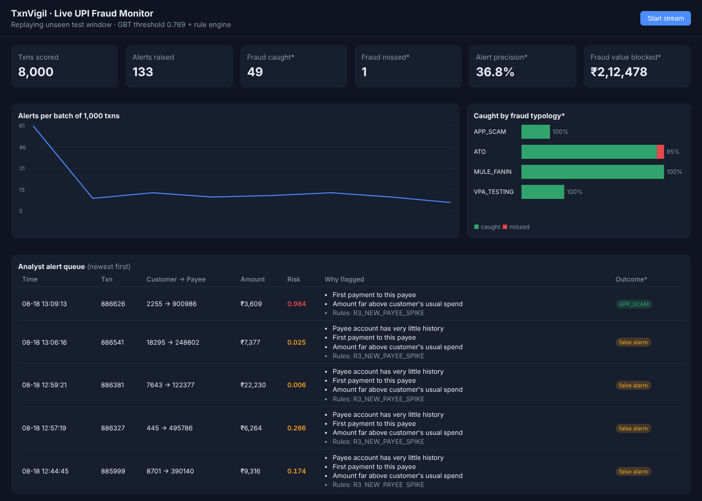
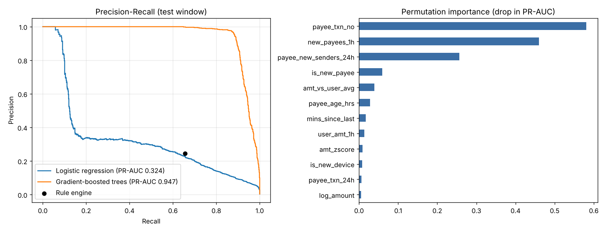

# TxnVigil — UPI Transaction Fraud Detection & Risk Scoring Engine

A rules + machine-learning fraud monitoring pipeline for UPI payments: behavioural feature
engineering, a gradient-boosted risk model, a rule-engine baseline, per-alert reason codes,
SQL fraud analytics, and a live analyst dashboard with streaming scoring.



## Why

Banks run a **rule engine** first ("new device + large amount → block"). Rules are explainable
but noisy: they produce large analyst queues and miss fraud that doesn't match a written rule.
TxnVigil measures how much a behavioural ML model adds on top of rules, under realistic
constraints: a fixed analyst alert budget, a time-based train/test split, and named fraud typologies.

## Results (unseen test window: 12 days, 218,672 txns, 823 frauds)

Alert budget: model threshold set so that 0.5% of validation-window transactions are alerted.

| Approach | Recall | Precision | False-positive rate | Alerts / day | Fraud value caught | PR-AUC |
|---|---|---|---|---|---|---|
| Rule engine (5 rules) | 65.6% | 24.4% | 0.77% | 184 | 74.4% | – |
| Logistic regression | 43.3% | 31.2% | 0.36% | 95 | 56.2% | 0.324 |
| **Gradient-boosted trees** | **91.3%** | **79.5%** | **0.09%** | **79** | **92.7%** | **0.947** |
| Hybrid (rules OR GBT) | 95.6% | 30.5% | 0.82% | 215 | 98.1% | – |

Recall by fraud typology (GBT): ATO 96.1% · Mule fan-in 94.1% · VPA testing 98.4% · **APP scam 54.5%**

**Takeaways**
- GBT catches **+26 pts more fraud than the rules with 57% fewer alerts** (79 vs 184/day).
- Logistic regression fails on APP scams (1%): the signal is an *interaction*
  (new payee × unusually large amount × payee with no history), which a linear model can't express and trees can.
- **APP (social-engineering) scams are the hardest** — the victim's own phone, normal hours, and the
  customer authorises the payment. Hybrid deployment (rules OR model) lifts APP recall to 79.5%, at the cost of a larger queue.
- Most important signals are on the **payee side** (mule behaviour), not just the customer side — see `reports/model_report.png`.



## Data

Real bank transactions are confidential, so — like the well-known **PaySim** simulator — `simulate.py`
generates **1,097,512 UPI transactions (20,000 customers, 60 days, 0.33% fraud)** and injects four typologies:

| Typology | Pattern |
|---|---|
| `ATO` | Account takeover: burst of high-value txns to a mule; 65% from a new phone, 35% via a remote-access app on the victim's own phone |
| `MULE_FANIN` | Fake-KYC / collect-request scam: 8–25 victims pay the **same** mule within ~3 days |
| `VPA_TESTING` | 2–4 txns of ₹1–10 to check the credentials work, then cash-out |
| `APP_SCAM` | Authorised push payment: one unusually large payment from the victim's own phone |

To make it hard (and honest), legit customers also pay never-seen VPAs, make large one-off payments,
send ₹1 transactions and have shopping bursts; half the mule accounts are "aged" with small transactions weeks earlier;
35% of fraudster accounts pose as merchants (P2M).

## Features (all computed from the past only — no leakage)

| Group | Features |
|---|---|
| Amount vs own history | amount ÷ customer's past average, z-score of log-amount |
| Velocity | txns & ₹ in last 1h, txns in 24h, minutes since last txn, ₹1–10 txns in 1h, new payees in 1h |
| Novelty | first payment to payee, new device, device age |
| Payee / mule | payee account age, payee txn count, inflow in 24h, **distinct first-time senders in 24h** |
| Context | hour, night flag, P2P vs P2M |

## How it works

```
simulate.py ─► transactions.csv ─► features.py ─► train.py ─► model.joblib + metrics.json + report.png
                     │                               │
                     └─► load_sql.py ─► SQLite ─► sql/fraud_queries.sql (analytics)
                                                     └─► app.py (Flask + SSE) ─► live dashboard
```

- **Time-based split:** train days 0–39, threshold tuning on days 40–47, test on days 48–59.
  A random split would leak future behaviour into training.
- **Class imbalance:** `class_weight="balanced"` instead of SMOTE (no synthetic rows; keeps the score ranking honest).
- **Threshold = business decision:** chosen for an alert budget analysts can handle, not 0.5.
- **Explainability:** permutation importance globally; per-alert **reason codes** ("Many first-time senders paid this payee in 24h") for analysts and auditors.
- **SQL analytics:** velocity self-joins, `LAG`, running averages with `ROWS BETWEEN UNBOUNDED PRECEDING AND 1 PRECEDING`, `RANK`, mule fan-in detection.

## Run it

```bash
pip install -r requirements.txt
python src/simulate.py            # ~1.1M txns -> data/transactions.csv   (~40 s)
python src/train.py               # features, models, metrics, report      (~1 min)
python src/load_sql.py            # SQLite for SQL analytics
sqlite3 data/txnvigil.db < sql/fraud_queries.sql
python src/app.py                 # open http://127.0.0.1:5000 and press "Start stream"
```

## Project layout

```
src/simulate.py     transaction simulator + fraud typologies
src/features.py     leakage-safe behavioural features
src/rules.py        rule engine baseline (R1–R5)
src/train.py        training, threshold tuning, evaluation, reports
src/explain.py      per-alert reason codes
src/load_sql.py     load data into SQLite
src/app.py          Flask + Server-Sent Events live scoring
sql/fraud_queries.sql   fraud analytics in SQL (window functions)
templates/dashboard.html analyst dashboard (no external JS dependencies)
reports/            metrics.json, model_report.png, dashboard.png, model.joblib
```

## Limitations (stated honestly)

- Data is **simulated**: the model learns patterns I designed, so real-world scores would be lower.
  The value is in the method (leakage-safe features, time split, alert budget, typology analysis), which carries over to real data.
- Labels are assumed known immediately; in reality fraud labels arrive days or weeks later (complaints, chargebacks).
- No concept drift: fraudsters adapt, so production models need monitoring and retraining.

## Next steps

- Swap in **XGBoost / LightGBM** and **SHAP** values for exact per-alert explanations
- Run the same pipeline on the public PaySim / IEEE-CIS datasets
- Graph features (mule networks: shared devices, money flowing through chains of accounts)
- Label-delay-aware evaluation and drift monitoring

## Related work

- PaySim — mobile-money transaction simulator for fraud research (Lopez-Rojas et al.)
- *Reproducible Machine Learning for Credit Card Fraud Detection — Practical Handbook* (Le Borgne, Bontempi et al., ULB)
- Jube — open-source real-time AML / fraud transaction monitoring (rules + ML)
- Kaggle Credit Card Fraud (ULB) — most public projects use its anonymised PCA features with random splits;
  TxnVigil instead builds interpretable behavioural features and evaluates on a future time window.

---
Author: Aditya Soni · B.Tech–M.Tech Cyber Security, NFSU Gandhinagar
