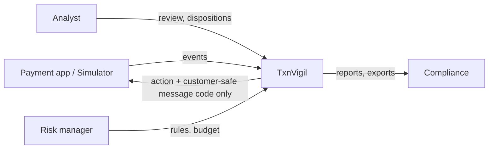
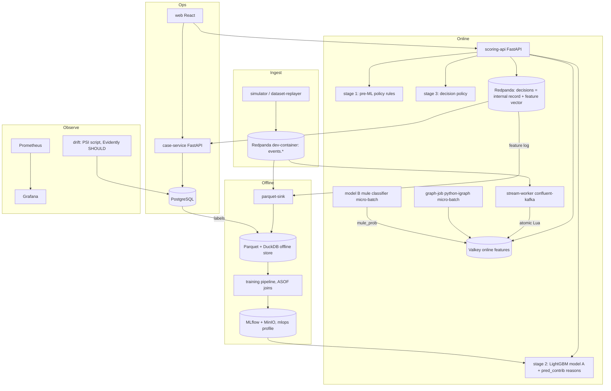

# TxnVigil v2 — Real-Time Transaction Risk & Mule-Detection Platform
## Complete Build Specification and Development Prompt

### Change log
| Version | Date | Section(s) | Change | Decision IDs |
|---|---|---|---|---|
| 2.0 | 2026-11-01 | all | Initial v2 specification with [R#] research markers | — |
| 2.1 | 2026-11-02 | all | Applied D-D R1–R6, D5 scope floor, FR-13a and RD-1 (#1–#13); every [R#] marker resolved | D-D R1–R6, D5, 9a, 9b, RD-1, CP-0 C2–C4/K2 |
| 2.1 | 2026-11-02 | Top, ToC, How-to-use note | Change log; [R#] markers now resolved by RD-1; research is input, not truth | RD-1 §0, D8 |
| 2.1 | 2026-11-02 | §1.2 | Reference notes: Valkey, Feast not used, version source = lockfiles | RD-1 §0, #3, #4, #6, #9 |
| 2.1 | 2026-11-02 | §3 | Latency vision 50 ms p99; public-dataset floor | RD-1 #5b, D5 |
| 2.1 | 2026-11-02 | §4.1 | R1/R5 research markers resolved (marker-only edit) | RD-1 #1, #5 |
| 2.1 | 2026-11-02 | §4.3 | US-04 SHOULD (UI), US-08 latency + caller view, US-09 COULD, US-10 via FR-13a | RD-1 #1c, #5b, 9a |
| 2.1 | 2026-11-02 | §4.4 | FR-02/07/12/14/16 updated; FR-11/13 SHOULD; new FR-13a MUST-lite; FR-17 COULD | D5, 9a, RD-1 #1c, #1d, #3, #5, #7, #9 |
| 2.1 | 2026-11-02 | §4.5 | NFR-01 latency, NFR-03 Valkey, NFR-07 HMAC, NFR-08 pyright + 80% gate, NFR-09 ≤ 3.5 GB | RD-1 #1d, #5b, #6, #6d, D-D R4, CP-0 C2 |
| 2.1 | 2026-11-02 | §4.7, §4.8 | Regulatory items resolved; risks: lockfile versions, research trust | RD-1 §0, #1, #1b–#1e, #6d, #7b |
| 2.1 | 2026-11-02 | §5 | New typologies; dual-sided features; P2P collect ended | RD-1 #2, #2b, #1e, RD-1 §0 |
| 2.1 | 2026-11-02 | §6.1–§6.4 | Dataset choice, D-D R6 data handling, simulator typologies + optional telemetry, realism checks | RD-1 #2, #2b, #3, #12, D-D R6, D5 |
| 2.1 | 2026-11-02 | §7 (all) | Valkey; 3-stage pipeline + 50 ms breaker; feature log-and-wait; caller vs internal split; tooling; compose | RD-1 #1c, #5, #5b, #6, #6b, #6c, #6d, #10, CP-0 C1–C4 |
| 2.1 | 2026-11-02 | §8.3 | Online implementation now Valkey (one-word edit) | RD-1 #6 |
| 2.1 | 2026-11-02 | §8.4–§8.9 | Scorecard metrics; pred_contrib reasons; governance artefacts; ADR list | RD-1 #3, #7, #7b, #8, CP-0 C6 |
| 2.1 | 2026-11-02 | §9 | F02 redefined; F25+ appended (cust_txn_cnt_total, payee/dual-sided, graph); igraph micro-batch | D-D R2, D-D R3, RD-1 #2, #4, #9, RD-1 §3 |
| 2.1 | 2026-11-02 | §10 | Models A/B/C, unweighted + isotonic, no XGBoost shadow, pred_contrib, FR-13a PSI | RD-1 #4, #7, FR-13a, D5 |
| 2.1 | 2026-11-02 | §11 | NPCI policy-rule defaults; `cust_txn_cnt_total` example; incremental backtest | RD-1 #1e, #8b, D-D R3 |
| 2.1 | 2026-11-02 | §12, §13 | Services, 3-stage handler, caller response vs internal decision record | RD-1 #1c, #5, #6, #6b, #7 |
| 2.1 | 2026-11-02 | §14 | No partitioning; cases + compliance timestamps; compliance_deadlines; Valkey keys; HMAC; audit | D-D R1, D-D R2, RD-1 #1, #1d, #5, #6, #6c |
| 2.1 | 2026-11-02 | §15.2 | Policy what-if and Models pages SHOULD | D5, 9a |
| 2.1 | 2026-11-02 | §16 | Base image wording, compose profiles (`mlops`), mem_limits, multi-arch, hosting | RD-1 §0, #6d, #11, CP-0 C3 |
| 2.1 | 2026-11-02 | §17 | pyright; scans; multi-arch; py matrix + deps-probe; lock job; ML gate baseline; ZAP nightly | RD-1 #10, #11, D-D R5, CP-0 C2, C4, K2 |
| 2.1 | 2026-11-02 | §18 | Valkey; perf targets (smoke+load MUST, stress/soak SHOULD); ZAP nightly; coverage wording | RD-1 #5b, #6, #10, D-D R4, D5 |
| 2.1 | 2026-11-02 | §19 | Valkey metrics; alert thresholds per new latency targets | RD-1 #5b, #6 |
| 2.1 | 2026-11-02 | §20 | HMAC pseudonymisation; case view/export audit; tipping-off; compliance mapping | RD-1 #1, #1c, #1d, #7b |
| 2.1 | 2026-11-02 | §21 | P0 deliverables (ADRs 0001–0005 + spec update); cut order 9b; D5 floor rule | D5, 9b, CP-0 C6 |
| 2.1 | 2026-11-02 | §22 | Added `scripts/`, `data/external/`, `legacy/v1/` | D-D R6, D4, §4.10 |
| 2.1 | 2026-11-02 | §23.3 | CV latency placeholder tied to `make perf` hardware notes | RD-1 #5b |
| 2.1 | 2026-11-02 | §24 | Rewritten as "Resolved research questions"; new §24.1 Open items for MASTERMIND | RD-1 §1 |

> **How to use this file.** It is both a design document and a build prompt. Give it, section by section,
> to yourself or to an AI coding agent ("Implement §12.3 exactly as specified, with the tests in §18.2").
> The former **[R#]** research markers are now **resolved by RD-1** (`docs/MASTERMIND_RD-1.md`); each resolved
> point cites "(RD-1 #n)", and earlier verdicts cite their ledger IDs (D-D R#, D5, 9a, 9b, CP-0 C#). The research
> itself is in `docs/RESEARCH.md` and is **input, not truth**: statistics, legal facts and versions in it are
> UNVERIFIED until their primary source has been opened (RD-1 §0). Remaining genuine conflicts are listed in §24.1;
> new decisions are recorded in `docs/DECISIONS.md` and §8.9 (ADRs).
>
> **Status legend:** `MUST` = in scope for v2 · `SHOULD` = do if time allows · `COULD` = stretch / future.
>
> **Honesty rule for the whole project:** every number that goes on the CV, README or slides must come
> from a script in this repo that anyone can re-run. Synthetic data is always labelled as synthetic.

---

## Table of contents

1. Origin, prior work and references
2. Audit of v1: what exists and its shortcomings
3. Vision, scope and non-goals
4. Requirements gathering & analysis
5. Domain model: fraud typologies → signals → features
6. Data strategy (synthetic simulator v2 + public datasets)
7. Architecture
8. Methodologies (delivery, ML, evaluation, decisioning, governance, ADRs)
9. Feature engineering specification
10. Machine learning: models, training, calibration, monitoring
11. Rule engine
12. Backend development
13. APIs & communication
14. Databases & storage
15. Frontend development
16. Containerization & hosting
17. CI/CD pipelines
18. Testing: unit, integration, ML, E2E, performance, security
19. Observability
20. Security, privacy & compliance
21. Delivery plan (phases, milestones, acceptance)
22. Repository structure
23. Definition of done, demo script, CV/interview outputs
24. Resolved research questions (24.1 Open items for MASTERMIND)
25. Glossary

---

## 1. Origin, prior work and references

### 1.1 Where v1 came from
TxnVigil v1 (folder `txnvigil/`, ~750 lines) was written from scratch in October 2026. It was **not copied
from any repository**. Its design borrowed *ideas* (not code) from these sources:

| Source | What was borrowed | Type |
|---|---|---|
| **PaySim** — Lopez-Rojas, Elmir & Axelsson, *"PaySim: A financial mobile money simulator for fraud detection"*, EMSS 2016 | Idea of simulating mobile-money transactions and injecting fraud because real bank data is confidential | Paper + simulator + Kaggle dataset |
| **Reproducible Machine Learning for Credit Card Fraud Detection — Practical Handbook** — Le Borgne, Siblini, Lebichot, Bontempi (ULB, 2022) | Time-based train/test split, delay between transaction and label, alert-budget metrics (precision@k), behavioural "customer spending" features | Free online book + code |
| **Jube** (jube-home/aml-fraud-transaction-monitoring, GitHub) | Real-time monitoring that runs rules and ML side by side, with case management | Open-source product (C#) |
| **Kaggle "Credit Card Fraud Detection" (ULB, Dal Pozzolo et al. 2015)** and the many GitHub notebooks built on it | Used as the *negative* example: anonymised PCA features + random split + SMOTE + accuracy, which v1 deliberately avoided | Dataset + notebooks |

### 1.2 References v2 must study and cite (open each primary link before citing it — RD-1 §0; dataset choice RD-1 #3, models RD-1 #4, architecture RD-1 #5)
**Datasets / simulators**
- PaySim (Lopez-Rojas et al., 2016) — mobile money, ~6.3M rows.
- BankSim (Lopez-Rojas & Axelsson, 2014) — card payments by merchant category.
- IEEE-CIS Fraud Detection (Kaggle 2019, Vesta) — real e-commerce, rich device/identity fields.
- ULB Credit Card Fraud (Dal Pozzolo et al., 2015) — real, PCA-anonymised.
- Sparkov / "Credit Card Transactions Fraud Detection" (Kaggle, generated with Sparkov) — card, geo, merchant.
- IBM **AMLworld** — Altman et al., *"Realistic Synthetic Financial Transactions for Anti-Money Laundering Models"*, NeurIPS 2023 Datasets & Benchmarks.
- IBM **AMLSim** — agent-based AML transaction simulator (GitHub).
- **SAML-D** — Oztas et al., 2023, synthetic AML dataset with typologies.
- **Elliptic / Elliptic++** — Weber et al., 2019 (graph of Bitcoin transactions, illicit labels).
- Amazon **Fraud Dataset Benchmark (FDB)** — collection of fraud datasets with a common loader.

**Methods**
- Lundberg & Lee, *"A Unified Approach to Interpreting Model Predictions"* (SHAP), NeurIPS 2017; TreeSHAP (2020).
- Dal Pozzolo et al., *"Calibrating Probability with Undersampling for Unbalanced Classification"*, 2015.
- Grinsztajn, Oyallon & Varoquaux, *"Why do tree-based models still outperform deep learning on tabular data?"*, NeurIPS 2022.
- Graph methods for mule/AML detection (GraphSAGE, GNNs on AMLworld) — engineered graph features MUST, GNN ablation COULD (RD-1 #9). Third-party benchmark numbers are never quoted as TxnVigil results (RD-1 §0).

**Industry / regulatory (India)** — decisions in RD-1 #1 and #7b; every legal fact UNVERIFIED until its primary source is opened (RD-1 §0)
- RBI Master Directions on Fraud Risk Management (2024).
- RBI Innovation Hub **MuleHunter.AI** (mule-account detection initiative).
- RBI FREE-AI framework (responsible AI in finance, 2025).
- Digital Personal Data Protection Act 2023 and DPDP Rules.
- NPCI UPI risk and fraud-monitoring guidelines; FIU-IND suspicious transaction reporting.

**Engineering**
- Valkey (Redis-compatible, BSD-3; RD-1 #6), Redpanda/Kafka, FastAPI, LightGBM, python-igraph, DuckDB, MLflow,
  Evidently, Prometheus/Grafana, Testcontainers, Playwright, k6/Locust — versions = whatever uv.lock /
  pnpm-lock.yaml / CI-pulled image tags record (RD-1 §0). Feast was evaluated and is not used (RD-1 #6).

### 1.3 How v2 must be better than every source
| Source | Its limitation | TxnVigil v2 answer |
|---|---|---|
| PaySim | Few behaviour signals, no devices/logins, no mule networks, fraud is easy to spot from balance fields | Event-based simulator (logins, device binding, beneficiary adds, SIM swap, payments) with mule rings and realistic noise; validated realism (§6.4) |
| ULB Handbook | Batch notebooks; no serving, no case management, no graph features | Real-time scoring API, online feature store, analyst workflow, graph mule features |
| Jube | Heavy C# product; ML not transparent; not India/UPI specific | Python, explainable (SHAP reason codes), UPI typologies, RBI/DPDP-aware design |
| Kaggle notebooks | Random splits, leakage, accuracy metric, no deployment | Time-split + label delay, alert-budget metrics, CI-gated model, deployed demo |
| TxnVigil v1 | See §2 | All MUST items in this spec |

---

## 2. Audit of v1: what exists and its shortcomings

### 2.1 Inventory
| File | What it does |
|---|---|
| `src/simulate.py` | Generates ~1.1M UPI-like transactions (20k users, 60 days), injects 4 typologies (ATO, mule fan-in, VPA testing, APP scam) |
| `src/features.py` | 20 past-only behavioural features with pandas rolling windows |
| `src/rules.py` | 5 hard-coded Python rules |
| `src/train.py` | Time split, rules vs logistic regression vs sklearn HistGradientBoosting, alert-budget threshold, metrics.json, report PNG |
| `src/explain.py` | Heuristic reason codes (feature beyond legit 99th percentile) |
| `src/app.py` + `templates/dashboard.html` | Flask + SSE replay of pre-scored test window |
| `sql/fraud_queries.sql` | Analytics queries (window functions) on SQLite |

v1 results (synthetic): GBT recall 91.3%, precision 79.5%, PR-AUC 0.947 at a 0.5% alert budget vs rules 65.6% / 24.4%.

### 2.2 Shortcomings and how v2 fixes them
| ID | Shortcoming in v1 | Why it matters | v2 fix | Priority |
|---|---|---|---|---|
| S1 | Data generated by the same person who designed the model → circular, optimistic scores | Results don't transfer; interviewer will challenge | Simulator v2 with independent config + validation on ≥2 public datasets (PaySim, IEEE-CIS or AMLworld); report cross-dataset results | MUST |
| S2 | Features computed in batch with pandas; dashboard only replays pre-computed scores | Not real-time; offline/online skew impossible to test | Online feature store (Redis) updated per event; one feature definition used offline and online; parity tests | MUST |
| S3 | Labels assumed known instantly | Real labels arrive days/weeks later; inflates results | Label-delay simulation, delayed-feedback evaluation | MUST |
| S4 | No graph / network features | Mule rings are the core of UPI fraud | Transaction graph features (fan-in/out, 2-hop exposure, community risk) + investigation graph view | MUST |
| S5 | Rules hard-coded in Python | Analysts can't change them; no versioning/backtest | YAML rule DSL, versioned, hot-reloaded, backtest against history | MUST |
| S6 | Heuristic reason codes | Not exact; weak for regulators | SHAP TreeExplainer reason codes mapped to plain-language templates | MUST |
| S7 | One threshold, binary alert | Banks use tiered actions | Decision policy: ALLOW / STEP_UP (OTP/cool-off) / HOLD_REVIEW / BLOCK using cost matrix + alert budget | MUST |
| S8 | No case management or analyst feedback | No learning loop | Alert queue → case → disposition → label store → retraining | MUST |
| S9 | No model monitoring or retraining | Fraud drifts quickly | Drift (PSI/Evidently), performance tracking with delayed labels, champion–challenger | SHOULD |
| S10 | No API; no auth; ground-truth shown in UI | Not deployable; security gap | FastAPI scoring + management APIs, JWT + RBAC, audit log; ground truth only in "lab mode" | MUST |
| S11 | No tests, CI, containers | Not professional; can't be trusted | pytest/Testcontainers/Playwright/k6, GitHub Actions, Docker Compose | MUST |
| S12 | SQLite, pickles | Not concurrent; insecure model loading | PostgreSQL, Redis, Parquet/DuckDB offline store, MLflow registry (pickle only from trusted registry, or ONNX) | MUST |
| S13 | Single model family; single seed; no confidence intervals | Weak evidence | LightGBM + calibrated LR baseline + Isolation Forest (unknown patterns); multi-seed, bootstrap CIs, rolling-origin evaluation | MUST |
| S14 | Thin event model (no logins, devices, IP, SIM swap, beneficiary adds) | Misses the strongest real signals | Event-based schema (§6.3) | MUST |
| S15 | No privacy / governance artefacts | Banks require them | Data minimisation, pseudonymised IDs, model card, data sheet, DPIA-style note, audit trail | SHOULD |
| S16 | Dashboard canvas charts hand-made, single page | Hard to extend | React + TypeScript app with routing, components, tests | MUST |

---

## 3. Vision, scope and non-goals

**Vision.** An open, explainable, real-time platform that scores every UPI-style payment with p50 ≤ 15 ms and
p99 ≤ 50 ms at 200 RPS on a laptop (NFR-01, RD-1 #5b), detects mule networks, routes risky payments to tiered
actions, and gives analysts a case workflow whose decisions feed back into the model — demonstrably better than
rules alone on the simulator and at least one public dataset (D5).

**In scope (v2):** event simulator, public-dataset adapters, streaming feature pipeline, rules DSL,
ML training/registry, scoring API, decision policy, graph features, case management UI, monitoring,
CI/CD, containers, a hosted demo.

**Non-goals:** real bank integration, real customer data, payment-switch certification, production-grade
HA across regions, deep-learning research beyond one optional GNN experiment.

**Constraints:** one developer, laptop with 8–16 GB RAM, free/open-source tools only, ~6–8 weeks part-time.

---

## 4. Requirements gathering & analysis

### 4.1 Elicitation approach
1. **Document analysis:** RBI fraud directions, NPCI UPI guidelines, DPDP Act, public bank annual-report fraud
   sections, vendor docs (Feedzai, FICO Falcon, Featurespace, NICE Actimize) → resolved in RD-1 #1 and RD-1 #5.
2. **Proxy interviews:** 3–5 short conversations (faculty, bank-placed seniors, fraud/SOC professionals on
   LinkedIn). Use the question list in §4.9.
3. **Competitive analysis:** v1 + sources in §1.3.
4. **Prototyping:** v1 is the throwaway prototype; v2 requirements are written against its gaps.

### 4.2 Stakeholders & personas
| Persona | Goal | Pain today | What TxnVigil gives |
|---|---|---|---|
| **Fraud analyst (CFMU)** | Clear alerts fast, few false alarms | Long queues, no reason why | Ranked queue, reasons, customer timeline, one-click disposition |
| **Fraud/risk manager** | Lower loss within analyst capacity | Can't see trade-offs | Alert-budget dashboard, value-detection rate, rule/model performance |
| **Model risk / validation** | Prove model is sound & fair | Black boxes | Model card, versioned data/models, reproducible evaluation, drift reports |
| **Compliance / vigilance** | Timely reporting, audit trail | Manual evidence | Immutable audit log, case export, STR-ready summaries |
| **IT security** | No new attack surface | Unvetted tools | Threat model, RBAC, secrets management, scans in CI |
| **Customer** (indirect) | Payments not blocked wrongly | Friction | Step-up instead of block where risk is moderate |

### 4.3 User stories (with acceptance criteria)
- **US-01** As an analyst, I see new alerts within 2 s of the payment, sorted by risk, so I can act before money moves on.
  *AC:* alert appears in queue ≤ 2 s (p95) after `POST /score`; sorted by score desc; shows amount, payee, top-3 reasons.
- **US-02** As an analyst, I open an alert and see the customer's last 30 days, devices, beneficiaries and the payee's network.
  *AC:* case page loads ≤ 1.5 s; timeline, device list, 2-hop graph rendered.
- **US-03** As an analyst, I mark an alert *Fraud / Not fraud / Need info*, with a note.
  *AC:* disposition stored with user, timestamp, previous state; appears in label store within 1 min.
- **US-04** As a risk manager, I set the daily alert budget and see the expected recall / precision trade-off before applying.
  *AC:* what-if curve from latest evaluation; change is versioned and audited. *Priority:* what-if **UI** = SHOULD;
  the policy API (`GET/PUT /v1/policy`, versioned + audited) stays MUST under FR-06 (D5, 9a).
- **US-05** As a risk manager, I write a new rule in YAML, backtest it on the last N days and publish it.
  *AC:* backtest returns hits, precision, overlap with model; publish creates a new rule-set version without restart.
- **US-06** As model risk, I see which model version made each decision and can reproduce its evaluation.
  *AC:* every decision row stores `model_version`, `ruleset_version`, `feature_schema_version`; `make evaluate MODEL=x` reproduces metrics.
- **US-07** As an admin, I manage users and roles. *AC:* RBAC enforced on API, not only UI.
- **US-08** As a payment system, I call the score API and get a decision (action + generic customer-safe message code
  only — RD-1 #1c) with p50 ≤ 15 ms and p99 ≤ 50 ms at 200 RPS. *AC:* the k6 load test (§18.7) passes via `make perf` on
  the user's laptop with hardware notes recorded; CI runs only a smoke perf test with p99 ≤ 250 ms (RD-1 #5b).
- **US-09** (COULD — 9a, FR-17) As compliance, I export a case as PDF/JSON with evidence. *AC:* export contains timeline, reasons, analyst actions, hashes; any "FMR-like"/"STR-like" layout is labelled "illustrative — not an official RBI/FIU-IND format" (RD-1 #1b).
- **US-10** As a manager, I get alerted when data drift or detection rate drops. *AC:* PSI > 0.2 on any top-10 feature raises a monitoring alert — satisfied by FR-13a (MUST-lite, 9a); the recall-drop > 10 pts alert belongs to FR-13 (SHOULD).

### 4.4 Functional requirements
| ID | Requirement | Priority |
|---|---|---|
| FR-01 | Ingest events: `login`, `device_bind`, `sim_change`, `beneficiary_add`, `payment` | MUST |
| FR-02 | Score each payment synchronously in 3 stages: features → pre-ML policy rules → model + reasons → policy → decision, with a 50 ms circuit breaker to rules-only (RD-1 #5); the caller receives only action + generic message code, reasons go to the internal decision record (RD-1 #1c); the exact feature vector used is logged (RD-1 #5) | MUST |
| FR-03 | Maintain online features per customer, device, payee and graph node in near real time | MUST |
| FR-04 | Same feature definitions for offline training and online serving, verified by parity tests | MUST |
| FR-05 | Rule DSL with versioning, enable/disable, priority, backtest, hot reload | MUST |
| FR-06 | Decision policy with 4 actions and configurable thresholds / cost matrix / alert budget; policy API MUST, what-if UI SHOULD (9a) | MUST |
| FR-07 | Reason codes: top-k LightGBM `pred_contrib=True` (native TreeSHAP) contributions mapped through the reason-code dictionary RC01–RCnn to plain-language templates, plus fired rules (RD-1 #7) | MUST |
| FR-08 | Alert queue, case management, dispositions, notes, assignment, SLA timers, compliance timestamps + computed deadlines (RD-1 #1) | MUST |
| FR-09 | Label store fed by dispositions + delayed "chargeback/complaint" labels from simulator | MUST |
| FR-10 | Training pipeline: dataset build → train → evaluate → register; reproducible from a commit | MUST |
| FR-11 | Model registry with stages (staging / production / archived) and champion–challenger shadow scoring (two LightGBM versions, RD-1 #4); manual promote stays (9b) | SHOULD (9a) |
| FR-12 | Graph features (mule risk) computed by a python-igraph micro-batch job (every 5 min in demo, configurable) and served online (RD-1 #9) | MUST |
| FR-13 | Monitoring: service metrics, data drift (Evidently), prediction drift, delayed-label performance | SHOULD (9a) |
| FR-13a | PSI drift script per top-10 feature with alert threshold (PSI > 0.2 default) — the minimal drift check that stays when FR-13 is cut | MUST-lite (D5, 9a) |
| FR-14 | Dataset adapters into a common schema: simulator v2 + ONE public dataset = IBM AMLworld HI-Small (MUST); IEEE-CIS second dataset (SHOULD); SAML-D (COULD) (D5, 9a, RD-1 #3) | MUST (narrowed) |
| FR-15 | Lab mode: replay a dataset at N× speed with ground truth visible (demo only, off by default) | MUST |
| FR-16 | Audit log of every config change, login, disposition and every case view/export (append-only, hash-chained) (RD-1 #1d) | MUST |
| FR-17 | Case export (JSON + PDF); regulatory-style layouts illustrative only (RD-1 #1b) | COULD (9a) |
| FR-18 | Optional GNN experiment for mule detection, reported separately (RD-1 #9) | COULD |

### 4.5 Non-functional requirements
| ID | Category | Target |
|---|---|---|
| NFR-01 | Latency | `POST /v1/score` p50 ≤ 15 ms, p99 ≤ 50 ms at 200 RPS on the user's laptop, measured with `make perf` and recorded with hardware notes in `reports/perf/`; stretch goal p99 ≤ 15 ms. **No hard latency gate on GitHub-hosted runners**; CI smoke perf only, p99 ≤ 250 ms (§18.7, RD-1 #5b) |
| NFR-02 | Throughput | ≥ 500 events/s sustained through stream pipeline on laptop |
| NFR-03 | Availability (demo) | If Valkey or the model is unavailable, or the model stage exceeds the 50 ms circuit breaker → fall back to rules-only with `degraded=true` flag; never 500 to the caller (RD-1 #5, #6) |
| NFR-04 | Explainability | 100% of non-ALLOW decisions carry ≥ 1 reason |
| NFR-05 | Reproducibility | Same commit + seed → metrics within ±0.5 pt |
| NFR-06 | Security | OWASP ASVS L1 basics; no secrets in repo; dependency + image scans pass; JWT + RBAC |
| NFR-07 | Privacy | Identifiers pseudonymised with keyed HMAC (key from env); no real PII; every case view/export audited; retention policy configurable (RD-1 #1d) |
| NFR-08 | Maintainability | Typed Python (pyright strict on `core/` — CP-0 C2, RD-1 #10); CI gate ≥ 80% unit coverage on `core/`, 90% is a goal, not a gate (D-D R4) |
| NFR-09 | Portability | `docker compose up` works on Linux/Windows (WSL2)/macOS; `core` profile with explicit `mem_limit`s, target ≤ 3.5 GB RAM under load (RD-1 #6d; container list §16.2, open item §24.1) |
| NFR-10 | Usability | Analyst can disposition an alert in ≤ 3 clicks; WCAG AA colour contrast |

### 4.6 Data requirements
Entities: Customer, Account/VPA, Device, Payee/Merchant, Event, Payment, Alert, Case, Disposition, Label,
RuleSet, ModelVersion, Decision. Event schemas in §6.3; DB schema in §14.

### 4.7 Regulatory & domain requirements (resolved by RD-1 #1; every legal fact UNVERIFIED until its primary source is opened — RD-1 §0)
- Fraud classification and reporting timelines expected by RBI's fraud-risk directions → compliance timestamps
  (`occurred_at`, `detected_at`, `red_flagged_at`, `classified_fraud_at`) on cases plus deadlines computed from the
  `compliance_deadlines` config table, each default carrying its source URL and `verified=false` (§14.1, RD-1 #1, MUST-lite).
- Show-cause (SCN) process applies to classifying a *person/entity* as fraudulent → optional case sub-state, never on
  the payment path (RD-1 #1).
- Anti-tipping-off → the payment caller sees only action + generic customer-safe message code; reasons, rules and
  scores stay internal (§13.1, RD-1 #1c, MUST).
- Early-warning signals and data-analytics expectations in the same directions → features & dashboards.
- DPDP Act: purpose limitation, minimisation, retention, security safeguards → keyed-HMAC pseudonymisation and audit
  of every case view/export (§20, RD-1 #1d, MUST).
- RBI FREE-AI / model-governance expectations → MODEL_CARD.md, DATASHEET.md, FREE-AI mapping table, subgroup parity,
  human oversight (§8.8, RD-1 #7b, SHOULD).
- NPCI UPI rules → configurable pre-ML policy rules in the YAML ruleset (§11.2, RD-1 #1e, MUST): P2P collect = blocked
  (NPCI ended P2P collect requests from 2025-10-01 — confirmed in RD-1 §0); new-device cooling limit default
  ₹5,000/24h ("verify — not confirmed from NPCI primary document"); payee negative-list match.
- Regulatory exports ("FMR-like", "STR-like") are illustrative only, labelled "not an official RBI/FIU-IND format";
  no claim of FINnet compatibility (RD-1 #1b, COULD).

### 4.8 Assumptions, constraints, risks
| Risk | Impact | Mitigation |
|---|---|---|
| Synthetic data still too easy | Inflated metrics | Public-dataset validation; adversarial typologies; TSTR test (§6.4) |
| Laptop can't run full stack | Can't demo | Compose profiles (`core` / `mlops` / `obs` / `lab`) with explicit `mem_limit`s, core ≤ 3.5 GB under load; lightweight alternatives (Redpanda dev-container mode instead of Kafka) (RD-1 #6b, #6d) |
| Scope creep | Unfinished | MoSCoW; D5 scope floor; approved cut order (§21, 9b); phase gates (§21) |
| Feature skew online vs offline | Silent bugs | Single feature definition + parity tests; feature log-and-wait (RD-1 #5) |
| Tool versions change | Broken builds | No hand-pinned versions: versions = whatever uv.lock / pnpm-lock.yaml / CI-pulled image tags record (RD-1 §0, CP-0 K2); Renovate/Dependabot |
| Research claims wrong or outdated | Wrong limits, rules or citations | Research is input, not truth; facts UNVERIFIED until primary source opened; legal limits are configurable defaults (RD-1 §0) |

### 4.9 Interview questions for proxy stakeholders
1. What are the top 3 fraud types you see in UPI today, and how is each first noticed?
2. How many alerts can one analyst clear per day? What makes an alert fast or slow?
3. Which actions exist besides block (cool-off, OTP, call-back, hold)?
4. How long until you know a payment was fraud? Where do labels come from?
5. What evidence must a case file contain for reporting?
6. What would make you distrust a model's alert?

### 4.10 Traceability
Maintain `docs/traceability.csv`: `requirement_id, story_id, design_section, test_ids`. CI fails if a MUST
requirement has no linked test (simple script in §17).

---

## 5. Domain model: typologies → signals → features

Every typology is modelled **dual-sided**: payer-side features (victim behaviour) *and* payee-side features
(mule behaviour) (RD-1 #2). v1's four typologies (ATO, mule fan-in, VPA testing, APP scam) are kept; digital arrest,
task/job scam, APK/screen-share takeover and 2–3 hop mule layering are added (RD-1 #2, MUST).

| Typology | Real-world pattern (India) | Observable signals | Payer-side features | Payee-side features |
|---|---|---|---|---|
| Account takeover (ATO) (v1) | Phishing / SIM swap → attacker drains account | New device, SIM change, login from new IP/ASN, burst of payments, new payees, night | Device age, SIM-change recency, login-to-payment gap, velocity, new-payee count | Payee age, new-sender count, pass-through |
| APK / screen-share takeover (RD-1 #2) | Victim sideloads a malicious APK or shares screen (AnyDesk-type / messaging app); payments from victim's own device | Long session, active call or screen share, unusual navigation speed, many beneficiary adds, payments to new payees | Session features, beneficiary-add velocity, payee novelty; optional `is_screen_sharing`, `is_call_active` (RD-1 #2b) | Payee new-sender count, mule_prob |
| Mule fan-in (v1) | Many victims pay one account (fake KYC, lottery, job scams) | Payee receives from many first-time senders, quick outflow | New-payee flag, amount vs history | Payee in-degree (24h), new-sender ratio, pass-through ratio, dwell time, account age |
| 2–3 hop mule layering (RD-1 #2) | Money hops through 2–3 mule accounts quickly before cash-out | Short dwell time, in ≈ out, multi-hop paths, cycles | New-payee flag, amount vs history | Pass-through ratio, median dwell time, 2-hop exposure to known mules, 3-cycle flag, community fraud rate, PageRank |
| Credential / VPA testing (v1) | ₹1–10 test payments, then cash-out | Micro-payment burst then large payment to same payee | Small-txn count, max-amount jump | Payee micro-inflow count |
| APP scam — investment / generic (v1) | Victim authorises a large payment | Amount far above history, new payee, payee with poor history, sometimes repeated over days | Amount vs history, repeated-to-new-payee, time-since-beneficiary-add | Payee risk, mule_prob |
| Digital arrest (RD-1 #2) | Impersonated police / agency official keeps victim on a call and coerces repeated large transfers | Active call during payment, deposits broken just before paying, repeated large payments to new payees over days | Amount vs history, new payees per day, optional `is_call_active`, `fd_broken_1h` (RD-1 #2b) | Payee new-sender count, payee age, mule_prob |
| Task / job scam (RD-1 #2) | Small "rewards" paid to victim build trust, then escalating "deposits" to rotating payees | Small inbound credits followed by growing outflows, many new payees | Outflow escalation, new payees per day, amount vs history | Payee in-degree, pass-through, community fraud rate |
| P2M collect / policy-blocked P2P collect | Victim approves a "collect" thinking they'll receive money. NPCI ended P2P collect requests from 2025-10-01 (confirmed, RD-1 §0) → P2P collect is **blocked by a pre-ML policy rule** (RD-1 #1e); the residual ML typology is fraudulent **P2M** collect | Collect type, new requester, amount pattern; optional `qr_source = GALLERY` for QR variants (RD-1 #2b) | Request type, requester novelty | Requester (merchant) risk, age, negative-list match |

Typology set fixed by RD-1 #2. Statistics on typology prevalence in RESEARCH.md R2 are UNVERIFIED and are not
quoted in this spec (RD-1 §0).

---

## 6. Data strategy

### 6.1 Sources
1. **Simulator v2 (primary, MUST)** — event-based, agent-style entities, config-driven (§6.2).
2. **Public datasets** (RD-1 #3; D5 floor = ONE public dataset; 9a FR-14 narrowed):
   - **#1 MUST — IBM AMLworld HI-Small** (graph / mule typologies).
   - **#2 SHOULD — IEEE-CIS** (device / velocity fields); position 9 in the cut order (9b).
   - **SAML-D — COULD.**
   - **PaySim and ULB — not used for headline results.** Documented "why not" in `docs/data_sheet.md`: PaySim's
     balance fields leak the label (fraud is trivially separable), ULB is PCA-anonymised with no entity IDs, so no
     behavioural or graph features can be built (RD-1 #3).
   - Each dataset's licence is checked before use and recorded in `docs/data_sheet.md` (RD-1 #3).
3. **Adapters** convert each source to the common event schema; unsupported fields set to null and their
   features disabled via the feature registry.
4. **Third-party data handling (D-D R6):** no third-party dataset files in the repo or in CI; adapters are tested with
   tiny hand-made schema fixtures; public data lives in `data/external/` (gitignored) and is downloaded manually by
   the user; `make evaluate-public` documents the download and evaluation steps.

### 6.2 Simulator v2 specification
- **Implementation:** plain Python/NumPy discrete-event generator; no Mesa/SimPy dependency unless a WORKER shows a
  need (RD-1 #12).
- **Agents:** customers (segments: student, salaried, small business, senior), merchants (MCC-like
  categories), mule accounts (recruited, aged, fresh), fraudsters (crews controlling mule rings).
- **Clock:** discrete event simulation, 1-second resolution, 90–180 days.
- **Legit behaviour:** per-customer Poisson/Hawkes activity with daily and weekly seasonality, salary-day
  spikes, festival spikes, merchant loyalty, P2P social graph (small-world), device lifecycle (new phone
  every ~18 months), occasional travel (IP/ASN change), legit large payments (rent, fees), legit micro
  payments, legit beneficiary adds.
- **Fraud scenarios (each a parameterised script; §5, RD-1 #2):** v1's four — ATO (SIM swap / phishing), mule
  fan-in campaign, VPA testing, APP scam (single and multi-day) — plus digital arrest, task/job scam, APK /
  screen-share takeover, 2–3 hop mule layering, and P2M collect fraud. Attempted P2P collect requests are still
  generated so the pre-ML policy block can be tested (P2P collect ended by NPCI from 2025-10-01, RD-1 §0, #1e).
  Each has knobs: frequency, amount distribution, stealth level (how much it mimics legit).
- **Dual-sided behaviour (RD-1 #2):** each scenario also generates the payee/mule side — inflow bursts, dwell time,
  onward transfers, shared devices — so payee-side and graph features have signal.
- **Device telemetry (RD-1 #2b, SHOULD):** the simulator may emit the optional fields `is_call_active`,
  `is_screen_sharing`, `qr_source`, `fd_broken_1h` (§6.3), documented as "assumes PSP app SDK telemetry". Every
  headline model result is also reported **without** these fields (ablation) so results do not depend on data a
  bank may not have.
- **Adaptive adversary (SHOULD):** a "stealth" mode where fraud scripts copy the victim's typical
  hour/amount ranges, to test robustness.
- **Labels:** `is_fraud`, `typology`, `campaign_id`; **label delay** drawn per case (e.g. lognormal, median
  5 days, 10% never reported) → separate `labels` stream.
- **Output:** events to Redpanda (Kafka API) topics or Parquet files; deterministic by seed; config in YAML.
- **Scale targets:** 50k customers, 5–10M events (laptop), configurable.

### 6.3 Common event schema (JSON; enforce with Pydantic + JSON Schema)
```json
{
  "event_id": "uuid", "event_type": "payment|login|device_bind|sim_change|beneficiary_add",
  "ts": "2026-08-14T21:03:11.402Z", "customer_id": "c_9f2…", "account_id": "a_…",
  "device_id": "d_…", "ip_hash": "…", "asn": 55836, "channel": "UPI_P2P|UPI_P2M|UPI_COLLECT",
  "payment": {"payee_id": "p_…", "payee_type": "P2P|MERCHANT", "amount_paise": 1250000,
              "currency": "INR", "mcc": "5411|null", "note_len": 12},
  "session": {"session_id": "s_…", "duration_s": 340, "screen_share_flag": false},
  "telemetry": {"is_call_active": false, "is_screen_sharing": false, "qr_source": "CAMERA|GALLERY|null",
                "fd_broken_1h": false},
  "schema_version": "1.0"
}
```
Amounts in **paise (integers)** — never floats for money.
- `telemetry` is **OPTIONAL** and simulator-generated only, documented as "assumes PSP app SDK telemetry"; adapters
  for public datasets set it to null and the registry disables dependent features. A model ablation without these
  fields is required (RD-1 #2b, SHOULD).
- `channel = UPI_COLLECT` with `payee_type = P2P` is rejected by the pre-ML policy rule (P2P collect ended
  2025-10-01, RD-1 §0, #1e); P2M collect is scored normally.

### 6.4 Realism validation (answers "your data is fake")
Required realism checks (RD-1 #12, MUST):
- Amount distribution vs AMLworld (two-sample **KS** test).
- **Diurnal profile in IST** (hour-of-day histogram, Asia/Kolkata).
- **Degree distribution** of the payee graph with a **power-law fit**.
- **Benford first-digit** check on amounts.
- **Balance conservation** (no money created or destroyed across accounts).
- **TSTR rank correlation** against AMLworld (train on synthetic, test on real; rank models/features consistently);
  TRTS reported alongside.
- Tooling: SDMetrics SHOULD if it installs cleanly; otherwise SciPy implementations (RD-1 #12).
- Difficulty dials: report metrics at stealth levels 0/1/2 to show the model isn't only memorising easy patterns.
- Document all of this in `docs/data_sheet.md` (RD-1 #12).

### 6.5 Splits
Rolling-origin evaluation: train on weeks 1–6 → validate week 7 → test week 8; slide by one week, ≥ 3 folds.
Labels visible to training only if `label_ts < train_cutoff` (label-delay aware).

---

## 7. Architecture

### 7.1 System context


### 7.2 Containers

Notes: Valkey is accessed with redis-py-compatible client libraries (RD-1 #6). The online feature store is
hand-rolled with atomic Lua read/update scripts; **Feast is not used** (RD-1 #6). Redpanda runs in dev-container
mode (`--smp 1`, memory capped); consumers are plain `confluent-kafka` consumers — no Bytewax, Faust or Flink
(RD-1 #6b). Offline store = DuckDB + Parquet with ASOF joins for point-in-time training sets (RD-1 #6c).

### 7.3 Synchronous scoring path (targets p50 ≤ 15 ms, p99 ≤ 50 ms at 200 RPS — RD-1 #5b)
**3-stage pipeline (RD-1 #5):** (1) pre-ML policy rules (§11.2: P2P collect block, new-device cooling limit, payee
negative list, plus DSL rules) → (2) model A + reasons (`pred_contrib=True`) → (3) decision policy (§8.5).
**Circuit breaker 50 ms (RD-1 #5):** if stage 2 exceeds 50 ms or fails, the request is decided by stages 1 and 3 on
rules only, with `degraded=true`; the trip/reset policy is fixed in P4 and recorded in an ADR.
**Feature log-and-wait (RD-1 #5):** every decision publishes the exact feature vector used (inside the internal
decision record on topic `decisions`) → parquet-sink → `lake/feature_log/`; training uses these logged vectors
wherever available, so train/serve skew is zero by construction; the recomputed offline features are used only
where no logged vector exists.
```mermaid
sequenceDiagram
  participant C as Caller
  participant A as scoring-api
  participant V as Valkey
  participant M as Model A
  C->>A: POST /v1/score (payment event)
  A->>A: validate schema (≤1 ms)
  A->>V: Lua / pipeline read of feature keys (≤5 ms)
  A->>A: compute request-time features (≤2 ms)
  A->>A: stage 1 pre-ML policy rules (≤2 ms)
  A->>M: stage 2 predict + pred_contrib top-k (≤10 ms; breaker at 50 ms → rules-only)
  A->>A: stage 3 policy → action (≤1 ms)
  A-->>C: caller view: action + message code, event_id, request_id, degraded
  A--)Redpanda: publish internal decision record + feature vector (async)
  A--)V: update online state (async via stream-worker, atomic Lua)
```
The per-step budgets are design targets (sum ≈ 21 ms, leaving headroom to the 50 ms p99), not measurements; real
numbers come from `make perf` with hardware notes (RD-1 #5b).
Rule: the API never writes features synchronously; the stream-worker is the single writer → no race
conditions. For the *current* event, request-time features are computed in-process from the stored state.

### 7.4 Technology choices (versions = whatever uv.lock / pnpm-lock.yaml / CI-pulled image tags record — RD-1 §0)
| Concern | Choice | Why | Alternative |
|---|---|---|---|
| Language | Python (`requires-python >=3.12`; CI matrix 3.12 + 3.13 during P0–P1, one version chosen at CP-1 — CP-0 C4), TypeScript (UI) | Ecosystem | — |
| API | FastAPI + Uvicorn, Pydantic v2 | Async, OpenAPI for free, typing | Litestar |
| Streaming | Redpanda (Kafka API) in dev-container mode, `--smp 1`, memory capped (RD-1 #6b) | Single binary, light on laptop | Apache Kafka (KRaft) |
| Stream processing | Plain consumers with `confluent-kafka` (MUST); no Bytewax / Faust / Flink (RD-1 #6b) | Simple, testable | — |
| Online store | Valkey (BSD-3, Redis-compatible; sorted sets for time windows, hashes for profiles, capped lists), redis-py-compatible client, hand-rolled feature store with atomic Lua scripts (RD-1 #6, CP-0 C1) | Sub-ms reads, open licence | Redis (licence), Feast — not used (RD-1 #6) |
| OLTP | PostgreSQL — latest stable major image that CI pulls (try 18, else 17); tag recorded in compose (CP-0 C3, RD-1 #6c) | Cases, labels, audit, configs | — |
| Offline store | Parquet + DuckDB, ASOF joins for point-in-time training sets (RD-1 #6c) | Fast analytics on laptop | ClickHouse |
| ML | LightGBM (models A and B), scikit-learn (LR, Isolation Forest, isotonic), Optuna; `shap` library offline only for plots (RD-1 #4, #7) | Best tabular performance, native TreeSHAP via `pred_contrib` | XGBoost — not adopted (RD-1 #4), CatBoost |
| Graph | python-igraph micro-batch (RD-1 #9); NetworkX only for UI ego-graphs; PyG GNN ablation COULD | Fast, laptop-scale | Neo4j, GraphFrames |
| Registry/tracking | MLflow + MinIO (S3), `mlops` profile only (RD-1 #6d) | Standard | W&B |
| Orchestration | Makefile + Prefect (SHOULD) | Simple schedules | Dagster |
| Monitoring | Prometheus, Grafana, PSI script (FR-13a, MUST-lite), Evidently (SHOULD) | Standard | — |
| Frontend | React 18 + TS + Vite, TanStack Query/Router, Tailwind, Recharts, Cytoscape.js; pnpm, Vitest, Playwright (RD-1 #10) | Productive, testable | Svelte |
| Auth | JWT (own) MUST; Keycloak OIDC COULD | Simple first | — |
| Type checking / lint | pyright (strict on `core/`), ruff lint + format (CP-0 C2, RD-1 #10) | Fast, one toolchain | — |
| Tests | pytest, hypothesis, Testcontainers, schemathesis, Playwright, k6 | Coverage of all levels | Locust |
| Packaging | uv (Python), pnpm (JS), Docker multi-stage, multi-arch amd64 + arm64 via buildx (RD-1 #11) | Fast, reproducible | poetry |

### 7.5 Failure modes & fallbacks
| Failure | Behaviour |
|---|---|
| Valkey down | Score with rules + request-time features only; `degraded=true`; alert ops |
| Model stage > 50 ms or errors | Circuit breaker → rules-only decision, `degraded=true` (RD-1 #5) |
| Model load fails | Keep last good model in memory; if none, rules-only |
| Redpanda down | API still answers; decisions (with feature vectors) buffered to local file and replayed |
| Postgres down | Scoring unaffected; case UI read-only error |
| Feature schema mismatch | Model refuses to load (schema hash check) → previous model |

### 7.6 Security architecture (summary; details §20)
STRIDE threat model of the platform itself in `docs/threat_model.md`: spoofed events (mTLS/HMAC-signed
events in COULD), tampering with rules (RBAC + audit), repudiation (append-only audit), info disclosure
(pseudonymised IDs, least-privilege DB users), DoS (rate limits), elevation (role checks server-side).

### 7.7 Caller view vs internal decision record (RD-1 #1c, MUST)
- **Caller view** — what `POST /v1/score` returns to the payment system: `action`, a generic customer-safe
  `message_code`, `event_id`, `request_id`, `degraded`. Nothing else (anti-tipping-off).
- **Internal decision record** — risk score, reasons (RC codes + weights), rules fired, model/ruleset/feature/policy
  versions, latency and the exact feature vector used. It goes only to topic `decisions`, PostgreSQL (`decisions`
  table) and the analyst UI behind RBAC. Examples of both in §13.1.

### 7.8 Compose core profile (RD-1 #6d)
`core` = valkey, redpanda, postgres, scoring-api, stream-worker, web — the six containers listed in RD-1 #6d — plus
**case-service as a 7th container** (kept as its own service; placement is an open item, §24.1). Every service has an
explicit `mem_limit`; target ≤ 3.5 GB RAM under load. MLflow and MinIO run only in the `mlops` profile.

---

## 8. Methodologies

### 8.1 Delivery
Iterative, 2-week phases (§21) with a demo at the end of each; Kanban board in GitHub Projects; every PR
references a requirement ID; trunk-based development with short-lived branches.

### 8.2 ML lifecycle: CRISP-DM adapted
Business understanding (§4–5) → data understanding (EDA notebooks in `notebooks/` that never feed prod) →
data preparation (feature registry) → modelling → evaluation (§8.4) → deployment (registry → API) →
monitoring (§10.6).

### 8.3 Feature-parity design
Each feature is declared once in `core/features/registry.py` with: entity, window, aggregation, filter,
dtype, default, and two implementations generated from the same spec: an **offline** DuckDB SQL / Polars
expression and an **online** Valkey update/read function. Parity test: replay 10k events through the online
path and compare with offline values (tolerance 1e-6, or exact for counts).

### 8.4 Evaluation protocol
- Rolling-origin time splits (≥ 3 folds), label-delay aware.
- Metrics: PR-AUC; recall, precision and **value detection rate** at fixed alert budgets (0.1%, 0.5%, 1%);
  alerts/day; false-positive ratio (FP per TP); per-typology recall; stealth-level recall; latency.
- **Production scorecard module** `ml/scorecard.py` (RD-1 #8, MUST), computed for every model and ruleset:
  - **VDR** — value detection rate = fraud ₹ caught / fraud ₹ total;
  - **ADR** — account detection rate = compromised or mule accounts alerted at least once during their episode / all
    such accounts;
  - **AFR** — alert-to-fraud ratio, reported as FP:TP;
  - **precision@K** at the daily alert budget K;
  - **friction rate** — share of payments receiving STEP_UP / HOLD_REVIEW / BLOCK (also reported for legitimate
    payments only);
  - **time-to-detect** — time (and number of fraudulent payments) from an account's first fraudulent event to its
    first alert;
  - **net savings ₹** = fraud ₹ prevented − missed fraud ₹ − review cost × alerts − friction cost on false positives,
    with the cost assumptions stated in the report and taken from the policy config (§8.5).
  - **VDR-vs-alert-volume curve** in the evaluation report and in the UI (RD-1 #8).
- Baselines: rules-only, logistic regression, LightGBM, rules ∪ LightGBM, LightGBM + graph features.
- Uncertainty: bootstrap 95% CIs over test days; 3 seeds.
- Cross-dataset: same pipeline on the simulator and AMLworld HI-Small (MUST); IEEE-CIS when available (SHOULD) (RD-1 #3, D5).
- Ablations: remove each feature family; report drop. Required: without the optional device-telemetry fields
  (RD-1 #2b) and class-weighted vs unweighted Model A (RD-1 #4).
- Fairness: subgroup FPR and alert-rate parity across synthetic customer segments (RD-1 #7b).
- Report generated by `make report` → `reports/eval_<model_version>.md` + plots. No metric is quoted anywhere unless
  it comes from this report.

### 8.5 Decision policy (cost-sensitive)
Expected cost per action: `E[cost|a] = p·loss_if_fraud(a, amount) + (1−p)·friction_cost(a)`. Choose
the action with the lowest expected cost, subject to a daily HOLD/BLOCK budget. Defaults (configurable):
friction ALLOW=0, STEP_UP=₹5 equivalent, HOLD=₹50, BLOCK=₹200; fraud loss fraction ALLOW=1.0,
STEP_UP=0.3, HOLD=0.05, BLOCK=0. Requires **calibrated** probabilities (§10.4).

### 8.6 Explainability method
Native TreeSHAP via LightGBM `predict(..., pred_contrib=True)` at inference for the scored row — no `shap` library
on the hot path; `shap` is used only offline for plots (RD-1 #7). Top-3 positive contributions are mapped through
the **reason-code dictionary RC01–RCnn** (`core/explain/reason_codes.yaml`: code, feature(s), template, formatting)
to template text ("RC07: Payee received money from 14 new senders in 24h"); rules fired listed separately. If
stage 2 is skipped by the 50 ms circuit breaker, only rule reasons are recorded (RD-1 #5). Reasons appear only
in the internal decision record, never in the caller response (RD-1 #1c).

### 8.7 Threat modelling
STRIDE on data-flow diagram §7.2; each threat has a control and a test.

### 8.8 Model governance
Governance artefacts (RD-1 #7b, SHOULD):
- `MODEL_CARD.md` (intended use, data, metrics by slice, limitations, ethical notes) and `DATASHEET.md`
  (= `docs/data_sheet.md`: sources, licences, synthetic-data realism checks, "why not" for PaySim/ULB).
- A **mapping table to the RBI FREE-AI recommendations** (sutras / recommendations cited from the primary RBI report
  URL, e.g. `https://rbi.org.in/scripts/PublicationReportDetails.aspx?ID=1306` as listed in RESEARCH.md R7 —
  UNVERIFIED until opened, RD-1 §0) → TxnVigil control → evidence.
- **Subgroup FPR / alert-rate parity** across synthetic customer segments, reported in every evaluation.
- AIBOM (CERT-In): COULD.
- Human-in-the-loop for HOLD/BLOCK, documented retraining triggers, approval step before promotion
  (GitHub environment protection).

### 8.9 Architecture Decision Records
`docs/adr/NNNN-…md`, template: context, decision, consequences, status; no version pins in ADRs (CP-0 C6). Accepted
in P0 (CP-0 C6): **0001** Redpanda (dev-container mode) over Kafka; **0002** Valkey + hand-rolled Lua feature store
over Feast and Redis (licence + latency); **0003** LightGBM single GBDT family (no XGBoost shadow), unweighted
training + isotonic calibration, `pred_contrib` reason codes; **0004** own JWT + RBAC over Keycloak; **0005**
pyright + ruff + uv toolchain. **0006** monorepo (P1).

---

## 9. Feature engineering specification

All windows are **event-time**, past-only, include the current event where marked (cur).
The feature count is driven by the registry (`core/features/registry.py`); there is no fixed target number
(RD-1 §3). F-numbers are stable IDs: new features are appended (F25, F26, …) and existing F01–F24 are never
renumbered. Features are **dual-sided** — payer (customer) and payee (RD-1 #2).

| # | Feature | Entity | Window | Definition | Online implementation |
|---|---|---|---|---|---|
| F01 | amt_log | event | — | log1p(amount) | request-time |
| F02 | amt_vs_cust_median_recent | customer | ≤ 50 payments within 30d | amount / median of the customer's last ≤ 50 payments within 30 days (D-D R2) | capped list `c:{cid}:amt30` (LPUSH + LTRIM 50, entries `"epoch_ms:paise"`, entries older than 30d filtered at read); offline computes the identical definition → exact parity (D-D R2) |
| F03 | amt_z_cust_90d | customer | 90d | z-score of log amount | running mean/var (Welford) per customer |
| F04 | cust_txn_cnt_{1h,24h,7d} | customer | 1h/24h/7d | count incl. cur | ZSET by ts, ZCOUNT |
| F05 | cust_amt_sum_{1h,24h} | customer | 1h/24h | sum incl. cur | ZSET member=event_id score=ts + HASH amounts |
| F06 | micro_txn_cnt_1h | customer | 1h | count amount ≤ ₹10 | ZSET |
| F07 | new_payee_flag | customer×payee | all | first payment to payee | SET per customer (Bloom filter if large) |
| F08 | new_payees_cnt_24h | customer | 24h | count of first-time payees | ZSET |
| F09 | mins_since_beneficiary_add | customer×payee | — | minutes since payee added | HASH |
| F10 | device_age_h | customer×device | — | hours since first seen | HASH |
| F11 | sim_change_recency_h | customer | — | hours since last SIM change | HASH |
| F12 | login_to_pay_s | session | — | seconds from login to payment | HASH per session |
| F13 | ip_asn_novel | customer | 90d | ASN not seen before | SET |
| F14 | hour_sin/cos, is_night | event | — | cyclic hour | request-time |
| F15 | payee_age_h | payee | — | hours since first inflow | HASH |
| F16 | payee_in_cnt_24h | payee | 24h | inflow count | ZSET |
| F17 | payee_new_sender_cnt_24h | payee | 24h | distinct first-time senders | ZSET of first-pair events |
| F18 | payee_pass_through_24h | payee | 24h | outflow/inflow amount | two sums |
| F19 | payee_hold_time_med | payee | 7d | median dwell time — median minutes money stays (RD-1 #9) | HASH (graph micro-batch) |
| F20 | graph_mule_score | payee | micro-batch | `mule_prob` from Model B, the LightGBM account mule classifier (§10.1, RD-1 #4) | HASH `p:{pid}:stats` (batch) |
| F21 | two_hop_known_mule | payee | micro-batch | any confirmed mule within 2 hops (labels with `label_ts < batch_ts`) | HASH (batch) |
| F22 | community_fraud_rate | payee | micro-batch | labelled-fraud rate in the payee's Leiden community (RD-1 #9) | HASH (batch) |
| F23 | cust_segment | customer | static | segment code | HASH |
| F24 | collect_flag × requester_novelty | event | — | collect request from new requester. P2P collect is blocked by a pre-ML policy rule since NPCI ended it from 2025-10-01 (RD-1 §0, #1e), so in practice this scores **P2M** collect | request-time |
| F25 | cust_txn_cnt_total | customer | lifetime | lifetime payment count = Welford `n` (D-D R3) | HGET `c:{cid}:stats` n |
| F26 | payee_micro_in_cnt_1h | payee | 1h | inflows ≤ ₹10 (VPA testing seen from the payee side, RD-1 #2) | ZSET |
| F27 | payee_out_cnt_24h | payee | 24h | outflow count (payee-side cash-out velocity, RD-1 #2) | ZSET `p:{pid}:out` |
| F28 | tel_call_active, tel_screen_sharing, tel_qr_gallery, tel_fd_broken_1h | event | — | optional device-telemetry flags from §6.3 `telemetry`; null → feature disabled; "assumes PSP app SDK telemetry"; ablation without them required (RD-1 #2b, SHOULD) | request-time |
| F29 | g_in_degree, g_out_degree | account | graph window | in/out degree in the transaction graph (RD-1 #9) | HASH (batch) |
| F30 | g_pass_through_ratio | account | graph window | outflow ₹ / inflow ₹ over the graph window (RD-1 #9) | HASH (batch) |
| F31 | g_pagerank | account | graph window | PageRank (RD-1 #9) | HASH (batch) |
| F32 | g_fraud_ppr | account | graph window | personalised fraud PageRank seeded **only** with labels available at batch time (`label_ts < batch_ts`) (RD-1 #9) | HASH (batch) |
| F33 | g_cycle3_flag | account | graph window | account lies on a directed 3-cycle (RD-1 #9) | HASH (batch) |
| F34 | g_shared_device_degree | account | graph window | number of other accounts sharing a device with this account (RD-1 #9) | HASH (batch) |
| F35 | iforest_score | event | — | Model C Isolation Forest anomaly score, used as a feature and drift signal (RD-1 #4, SHOULD; cut order position 2, 9b) | request-time |
| F36 | is_collect, payee_is_p2p | event | — | collect-request flag and P2P-payee flag (inputs to the P2P-collect policy rule, §11.2, RD-1 #1e) | request-time |
| F37 | cust_amt_sum_24h_on_device_paise | customer×device | 24h | sum of payments from this device in the last 24h, incl. cur (input to the new-device cooling rule, §11.2, RD-1 #1e) | ZSET + HASH per customer×device |
| F38 | payee_negative_list_match | payee | — | payee is on the configured negative list (§11.2, RD-1 #1e) | SET `neg:payees` |

### 9.1 Graph features (MUST)
Micro-batch job using **python-igraph** (RD-1 #9), every 5 minutes in the demo (configurable), on the last 30 days:
directed weighted graph (account → payee, plus account–device edges). Computes in/out degree, pass-through ratio,
median dwell time, PageRank, personalised fraud PageRank (seeded only with labels available at batch time), Leiden
community fraud rate, 3-cycle flag, shared-device degree and 2-hop exposure to labelled mules (label-delay aware!)
→ F19–F22, F29–F34. Model B then writes `mule_prob` (F20) to Valkey (§10.1). NetworkX is used only for UI ego-graphs
if needed. PyG GNN ablation: COULD, compared in a separate experiment (RD-1 #9, FR-18).

### 9.2 Leakage guards
- No feature may use events after the scored event's timestamp (unit-tested with hypothesis).
- Graph labels only from labels with `label_ts < batch_ts`.
- Target encoding forbidden unless out-of-fold and time-aware.

---

## 10. Machine learning

### 10.1 Models
1. Rules-only baseline (current ruleset version).
2. Logistic regression (scaled, class-weighted, calibrated) — interpretable baseline.
3. **Model A — LightGBM transaction classifier** (primary, MUST; RD-1 #4): **unweighted training + isotonic
   calibration**; compared **once** in an ablation against a class-weighted variant (`is_unbalance` /
   `scale_pos_weight`), which is not the default. Monotone constraints where logical (e.g. risk non-decreasing in
   payee_new_sender_cnt), early stopping on time-validation PR-AUC.
4. **Model B — LightGBM account mule classifier** on graph + behavioural features (RD-1 #4): micro-batch after each
   graph-job run, writes `mule_prob` per account to Valkey (F20). SHOULD; MUST if P3 is on time.
5. **Model C — Isolation Forest** on legit-only data: anomaly score used as a feature (F35) and as a drift signal
   (RD-1 #4, SHOULD; cut order position 2, 9b).
6. GNN (COULD) — PyG ablation, separate notebook + report (RD-1 #9).
- **No XGBoost shadow model**: one GBDT family is enough; champion/challenger = two LightGBM versions (RD-1 #4,
  ADR-0003).

### 10.2 Training pipeline (`ml/pipeline.py`, `make train`)
1. Build dataset from Parquet with DuckDB using feature registry (offline mode) for a time window; use the
   **logged feature vectors** (`lake/feature_log/`, feature log-and-wait) wherever available, recomputed offline
   features only where none exist (RD-1 #5); point-in-time correctness via DuckDB ASOF joins (RD-1 #6c).
2. Join labels available as of cutoff.
3. Optuna search (≤ 50 trials) on fold 1–2; final fit on train+val.
4. Calibrate (isotonic on validation; check reliability curve, Brier score).
5. Evaluate on test folds → report.
6. Log params, metrics, artefacts, feature schema hash, data snapshot hash to MLflow.
7. Register as `Staging`; promotion to `Production` requires CI gate (§17) + manual approval.

### 10.3 Thresholds & policy
Derived from calibrated scores and §8.5; stored as `policy_version` in Postgres; UI what-if curve.

### 10.4 Calibration
Isotonic on the validation fold for Model A (RD-1 #4); the LR baseline may use isotonic or Platt. The
class-weighted ablation reports how much weighting distorts probabilities (reliability curve, Brier, ECE);
re-calibrate after each retrain.

### 10.5 Model packaging
LightGBM native text model + JSON feature schema (no arbitrary pickles in serving). Reasons come from
LightGBM `pred_contrib=True` (native TreeSHAP) — no SHAP explainer object and no `shap` import in serving; `shap`
is used only offline for plots (RD-1 #7). The reason-code dictionary RC01–RCnn is versioned with the feature
schema. Model loaded only if schema hash matches running feature registry.

### 10.6 Monitoring & retraining
- **FR-13a (MUST-lite, D5/9a):** `ml/drift/psi.py` computes PSI per top-10 feature (by Model A importance) daily
  against the training reference; PSI > 0.2 (configurable) raises a monitoring alert and writes a row to Postgres.
- Evidently drift reports: SHOULD (FR-13; cut order position 5, 9b — the PSI script stays).
- Daily: score distribution shift, Isolation Forest score shift (Model C, SHOULD), alert volume vs budget.
- Weekly: performance on labels that arrived (delay-aware), per typology, via the scorecard (§8.4).
- Champion–challenger (SHOULD, FR-11): a second LightGBM version scores in shadow; promote if better on ≥ 2
  consecutive weeks with CI overlap check; manual promote stays if cut (9b).
- Retraining trigger: schedule (weekly) or drift alert.

---

## 11. Rule engine

### 11.1 DSL (YAML, validated by JSON Schema)
```yaml
ruleset_version: 2026-11-02.1
rules:
  - id: R_NEW_DEVICE_HIGH_AMT
    description: High amount from a device first seen < 1h ago
    when: "device_age_h < 1 and amt_vs_cust_median_recent > 3 and cust_txn_cnt_total > 5"
    action: HOLD_REVIEW        # minimum action; policy may escalate
    score_boost: 0.25
    priority: 10
    enabled: true
    owner: risk_team
  - id: R_MICRO_BURST
    when: "micro_txn_cnt_1h >= 3"
    action: STEP_UP
```
- Expressions evaluated with a **safe expression evaluator** (e.g. `simpleeval`-style allow-list or a tiny
  parser) — never `eval()`. Only registry features are allowed names; unknown names fail validation.
- **The DSL validator test must accept every rule example in this spec** (§11.1 and §11.2) — the examples are
  part of the test fixtures (D-D R3).
- Rule sets are versioned rows in Postgres; API hot-reloads on publish event.
- **Backtest:** `POST /v1/rules/backtest` runs the ruleset on the offline store for a date range and returns
  hits/day, **total hits**, precision (on available labels), **incremental TP/FP vs the champion model** (hits the
  model would not have alerted), **marginal AFR** of the incremental alerts, overlap with model alerts and
  **₹ captured** (RD-1 #8b, MUST).

### 11.2 Pre-ML policy rules (stage 1, RD-1 #1e, MUST)
Shipped as **configurable** rules in the same YAML ruleset and evaluated before the model (stage 1, §7.3):
```yaml
  - id: R_POLICY_P2P_COLLECT_BLOCKED
    description: NPCI ended P2P collect requests from 2025-10-01 (confirmed, RD-1 §0)
    when: "is_collect == 1 and payee_is_p2p == 1"
    action: BLOCK
    stage: pre_ml
  - id: R_POLICY_NEW_DEVICE_COOLING
    description: New-device cooling limit; default 5,000 INR per 24h — verify, not confirmed from an NPCI primary document (RD-1 §0)
    when: "device_age_h < 24 and cust_amt_sum_24h_on_device_paise > 500000"
    action: HOLD_REVIEW
    stage: pre_ml
  - id: R_POLICY_PAYEE_NEGATIVE_LIST
    description: Payee matches the configured negative list
    when: "payee_negative_list_match == 1"
    action: BLOCK
    stage: pre_ml
```
Limits are configuration, not code; each policy rule records its source and verification status in the rule
description. The names `is_collect`, `payee_is_p2p`, `cust_amt_sum_24h_on_device_paise` and
`payee_negative_list_match` must exist in the feature registry (request-time features) so the validator accepts
these examples (D-D R3).

---

## 12. Backend development

### 12.1 Services
| Service | Responsibility | Tech |
|---|---|---|
| `scoring-api` | `/v1/score` (3-stage pipeline, 50 ms circuit breaker, caller view only), health, model/rules hot reload, metrics (RD-1 #1c, #5) | FastAPI |
| `stream-worker` | Consume `events.*`, update Valkey features via atomic Lua scripts, emit `features.updated` (RD-1 #6, #6b, #6d) | Python, plain `confluent-kafka` consumer |
| `case-service` | Alerts, cases (compliance timestamps + deadlines), dispositions, users, audit (incl. case views/exports), rules & policy admin, backtests (RD-1 #1, #1d) | FastAPI + SQLAlchemy 2 + Alembic |
| `graph-job` | Graph features micro-batch (every 5 min in demo, configurable) → Valkey + Parquet; triggers Model B `mule_prob` (RD-1 #4, #9) | Python, python-igraph |
| `trainer` | Training/eval pipeline, scorecard, registry | Python, MLflow (`mlops` profile) |
| `simulator` | Generate/replay events (Lab mode) | Python/NumPy |
| `parquet-sink` | Topic → partitioned Parquet, incl. the feature log from `decisions` (RD-1 #5) | Python |
| `drift-job` | PSI script (FR-13a, MUST-lite); Evidently reports (SHOULD) | Python |

### 12.2 Shared library `core/`
`core/schemas` (Pydantic events), `core/features` (registry + online/offline impl), `core/rules`
(DSL parser/evaluator), `core/policy`, `core/explain`, `core/model` (loader with schema check),
`core/money` (paise helpers), `core/time` (event-time utils). 100% typed; no I/O inside pure functions.

### 12.3 Scoring handler (pseudo-code)
```python
async def score(evt: PaymentEvent, request_id: str) -> CallerResponse:
    state = await feature_store.read(evt)              # one Valkey round-trip (atomic Lua read script)
    x = features.compute_request_time(evt, state)       # pure function, shared with offline
    # stage 1: pre-ML policy rules (P2P collect block, new-device cooling, negative list, DSL rules) — RD-1 #1e, #5
    fired = rules.evaluate(x, ruleset.current())
    # stage 2: model + reasons behind a 50 ms circuit breaker — RD-1 #5, #7
    degraded = state.degraded
    try:
        p, contrib = await breaker.call(model.predict_contrib, x, timeout_ms=50)  # calibrated prob + pred_contrib
        reasons = reason_codes.top_k(contrib, k=3) + rule_reasons(fired)          # RC01–RCnn templates
    except (BreakerOpen, TimeoutError, ModelUnavailable):
        p, reasons, degraded = None, rule_reasons(fired), True                    # rules-only
    # stage 3: policy
    action = policy.decide(p, evt.amount_paise, fired, budget.today())
    record = InternalDecision(evt.event_id, request_id, action, p, reasons, fired,
                              model.version, ruleset.version, features.schema_hash, policy.version,
                              feature_vector=x, degraded=degraded)                # RD-1 #1c, #5
    producer.publish("decisions", record)               # internal only; fire-and-forget, buffered → Postgres, Parquet feature log
    metrics.observe(record)
    return CallerResponse(evt.event_id, request_id, action,
                          message_code=messages.customer_safe(action), degraded=degraded)  # no reasons/scores (RD-1 #1c)
```

### 12.4 Cross-cutting
- Config via environment + pydantic-settings; 12-factor.
- Structured JSON logs with `trace_id`; OpenTelemetry tracing (SHOULD; cut order position 3, 9b).
- Idempotency: `event_id` dedupe in Valkey (24h TTL).
- Errors: problem+json (RFC 9457) responses.
- Rate limiting on public endpoints (slowapi or reverse proxy).
- DB migrations with Alembic; seed script for demo users.

---

## 13. APIs & communication

### 13.1 REST endpoints (versioned `/v1`, OpenAPI published at `/docs`)
| Method | Path | Role | Purpose |
|---|---|---|---|
| POST | `/v1/score` | service token | Score a payment; returns the **caller view only** — action + generic customer-safe message code, event_id, request_id, degraded flag (RD-1 #1c) |
| POST | `/v1/events` | service token | Ingest non-payment events (login, device, SIM, beneficiary) |
| GET | `/v1/alerts?status=&sort=` | analyst | Alert queue |
| GET | `/v1/alerts/{id}` | analyst | Alert detail with the internal decision record (reasons, rules, score, versions, feature vector); every view audited (RD-1 #1c, #1d) |
| GET/PATCH | `/v1/cases/{id}` | analyst, compliance | Case with compliance timestamps, computed deadlines, optional SCN sub-state; every view audited (RD-1 #1, #1d) |
| POST | `/v1/alerts/{id}/disposition` | analyst | Fraud / not fraud / need info + note |
| GET | `/v1/customers/{id}/timeline` | analyst | 30-day events |
| GET | `/v1/graph/{payee_id}?hops=2` | analyst | Subgraph for visualisation |
| GET/POST | `/v1/rulesets`, `/v1/rulesets/{v}/publish` | risk_manager | Manage rules |
| POST | `/v1/rules/backtest` | risk_manager | Backtest |
| GET/PUT | `/v1/policy` | risk_manager | Thresholds, budget, costs |
| GET | `/v1/models`, POST `/v1/models/{v}/promote` | model_risk | Registry view, promotion |
| GET | `/v1/metrics/summary` | manager | KPIs |
| GET | `/v1/audit` | admin/compliance | Audit log |
| POST | `/v1/auth/login`, `/v1/auth/refresh` | all | JWT |
| GET | `/healthz`, `/readyz`, `/metrics` | ops | Health, Prometheus |

**`POST /v1/score` response — caller view (RD-1 #1c).** Only these fields; no score, reasons, rules or versions
(anti-tipping-off):
```json
{"event_id":"…","request_id":"…","action":"HOLD_REVIEW","message_code":"MSG_PAYMENT_UNDER_REVIEW",
 "degraded":false}
```
**Internal decision record** — published to topic `decisions`, stored in Postgres `decisions`, shown only in the
analyst UI behind RBAC (RD-1 #1c, #5, #7). Illustrative values, not results:
```json
{"event_id":"…","request_id":"…","ts":"2026-08-14T21:03:11.420Z","action":"HOLD_REVIEW",
 "message_code":"MSG_PAYMENT_UNDER_REVIEW","risk_score":0.83,"stage2":"OK",
 "reasons":[{"code":"RC07","text":"Payee received money from 14 first-time senders in 24h","weight":0.31},
            {"code":"RC02","text":"Amount is 9.2× this customer's recent median","weight":0.22}],
 "rules_fired":["R_NEW_DEVICE_HIGH_AMT"],
 "versions":{"model":"lgbm-2026-11-02.3","ruleset":"2026-11-02.1","features":"a91c…","policy":"7"},
 "feature_vector":{"amt_log":9.43,"amt_vs_cust_median_recent":9.2,"payee_new_sender_cnt_24h":14,"…":"…"},
 "degraded":false,"latency_ms":18}
```

### 13.2 Real-time UI updates
Server-Sent Events `GET /v1/stream/alerts` (simple, one-way) — WebSocket only if bidirectional needs appear.

### 13.3 Topics (Redpanda)
| Topic | Key | Value | Producer → Consumer | Retention |
|---|---|---|---|---|
| `events.payment` | customer_id | PaymentEvent JSON | simulator/API → stream-worker, sink | 7d |
| `events.activity` | customer_id | login/device/sim/beneficiary | simulator/API → stream-worker, sink | 7d |
| `decisions` | event_id | Internal decision record incl. exact feature vector (internal only, RD-1 #1c, #5) | scoring-api → case-service, sink (feature log) | 30d |
| `labels` | event_id | Label (fraud, typology, label_ts, source) | simulator / case-service → sink | 90d |
| `features.updated` | entity_id | debug | stream-worker → (optional) | 1d |
Schemas versioned (JSON Schema in `contracts/`; Avro/Schema Registry COULD).

### 13.4 Contracts
OpenAPI generated from FastAPI → committed to `contracts/openapi.json`; frontend client generated from it
(openapi-typescript). CI fails if the generated spec changes without a version bump note.

---

## 14. Databases & storage

### 14.1 PostgreSQL (core tables)
```sql
CREATE TABLE decisions (
  event_id UUID PRIMARY KEY, ts TIMESTAMPTZ NOT NULL, customer_id TEXT NOT NULL, payee_id TEXT,
  amount_paise BIGINT NOT NULL, decision TEXT NOT NULL CHECK (decision IN ('ALLOW','STEP_UP','HOLD_REVIEW','BLOCK')),
  message_code TEXT NOT NULL,                       -- what the caller saw (RD-1 #1c)
  risk_score REAL,                                  -- NULL when stage 2 was skipped by the circuit breaker (RD-1 #5)
  reasons JSONB NOT NULL, rules_fired TEXT[] NOT NULL DEFAULT '{}',
  feature_vector JSONB NOT NULL,                    -- exact vector used (feature log-and-wait, RD-1 #5)
  model_version TEXT NOT NULL, ruleset_version TEXT NOT NULL, feature_schema TEXT NOT NULL,
  policy_version INT NOT NULL, degraded BOOLEAN NOT NULL DEFAULT false);
CREATE INDEX ON decisions (ts DESC); CREATE INDEX ON decisions (customer_id, ts DESC);

CREATE TABLE alerts (
  alert_id BIGSERIAL PRIMARY KEY, event_id UUID REFERENCES decisions, created_at TIMESTAMPTZ DEFAULT now(),
  status TEXT NOT NULL DEFAULT 'OPEN' CHECK (status IN ('OPEN','IN_REVIEW','CLOSED')),
  priority REAL NOT NULL, assigned_to TEXT, sla_due TIMESTAMPTZ);
CREATE INDEX ON alerts (status, priority DESC);

-- Cases with compliance timestamps (RD-1 #1, MUST-lite); additive, linked to alerts
CREATE TABLE cases (
  case_id BIGSERIAL PRIMARY KEY, alert_id BIGINT NOT NULL REFERENCES alerts,
  subject_id TEXT NOT NULL,                         -- HMAC-pseudonymised customer/payee id (RD-1 #1d)
  status TEXT NOT NULL DEFAULT 'OPEN' CHECK (status IN ('OPEN','IN_REVIEW','CLASSIFIED_FRAUD','CLOSED_NOT_FRAUD')),
  occurred_at TIMESTAMPTZ NOT NULL,                 -- first fraudulent event
  detected_at TIMESTAMPTZ NOT NULL,                 -- first alert
  red_flagged_at TIMESTAMPTZ,                       -- analyst red-flags the case
  classified_fraud_at TIMESTAMPTZ,                  -- classification as fraud
  -- optional SCN sub-state: only for classifying a person/entity as fraudulent; never on the payment path (RD-1 #1)
  scn_state TEXT NOT NULL DEFAULT 'NONE' CHECK (scn_state IN ('NONE','SCN_ISSUED','RESPONSE_RECEIVED','ORDER_PASSED')),
  scn_issued_at TIMESTAMPTZ,
  created_at TIMESTAMPTZ DEFAULT now());
CREATE INDEX ON cases (status, detected_at DESC);

-- Reporting deadlines are configuration, not code (RD-1 #1). Defaults from RESEARCH.md R1, UNVERIFIED until the
-- primary source is checked; `verified` flips to true only after someone opens source_url and confirms (RD-1 §0).
CREATE TABLE compliance_deadlines (
  event_type TEXT PRIMARY KEY,                      -- e.g. FMR_DUE, SCN_RESPONSE_DUE, STR_DUE
  anchor_column TEXT NOT NULL,                      -- cases column the deadline counts from
  deadline_rule TEXT NOT NULL CHECK (deadline_rule IN ('CALENDAR_DAYS','WORKING_DAYS')),
  default_value INT NOT NULL,
  source_url TEXT NOT NULL,
  verified BOOLEAN NOT NULL DEFAULT false,
  note TEXT);
-- Computed deadlines per case: view case_deadlines = cases × compliance_deadlines (anchor + rule/value).

CREATE TABLE dispositions (
  id BIGSERIAL PRIMARY KEY, alert_id BIGINT REFERENCES alerts, outcome TEXT CHECK (outcome IN ('FRAUD','NOT_FRAUD','NEED_INFO')),
  typology TEXT, note TEXT, user_id TEXT NOT NULL, ts TIMESTAMPTZ DEFAULT now());

CREATE TABLE labels (event_id UUID PRIMARY KEY, is_fraud BOOLEAN, typology TEXT, source TEXT, label_ts TIMESTAMPTZ NOT NULL);
CREATE TABLE rulesets (version TEXT PRIMARY KEY, yaml TEXT NOT NULL, created_by TEXT, created_at TIMESTAMPTZ DEFAULT now(), status TEXT);
CREATE TABLE policies (version SERIAL PRIMARY KEY, config JSONB NOT NULL, created_by TEXT, created_at TIMESTAMPTZ DEFAULT now(), active BOOLEAN);
CREATE TABLE users (user_id TEXT PRIMARY KEY, password_hash TEXT NOT NULL, role TEXT NOT NULL, active BOOLEAN DEFAULT true);
CREATE TABLE audit_log (id BIGSERIAL PRIMARY KEY, ts TIMESTAMPTZ DEFAULT now(), actor TEXT, action TEXT, entity TEXT, before JSONB, after JSONB, prev_hash TEXT, hash TEXT);
```
- `audit_log` is hash-chained (`hash = sha256(prev_hash || row)`) and the app DB user has INSERT-only on it. It
  records every config change, login, disposition **and every case view and export** (`action` = `CASE_VIEW`,
  `CASE_EXPORT`, `ALERT_VIEW`) (RD-1 #1d, FR-16).
- `decisions` keeps `PRIMARY KEY (event_id)`, the `alerts` FK and `CREATE INDEX ON decisions (ts DESC)`; **monthly
  partitioning = future** (D-D R1).
- Separate DB roles: `scoring_rw` (decisions insert), `case_rw`, `readonly`.
- PostgreSQL image: latest stable major that CI pulls (try 18, else 17); the tag used is recorded in compose (CP-0 C3,
  RD-1 #6c).
- `compliance_deadlines` seed rows (all `verified = false`; values and URLs as cited in RESEARCH.md R1 — UNVERIFIED):

| event_type | anchor_column | rule | default | source_url | note |
|---|---|---|---|---|---|
| FMR_DUE | classified_fraud_at | CALENDAR_DAYS | 14 (UNVERIFIED) | https://m.rbi.org.in/Scripts/BS_ViewMasDirections.aspx?id=12702 | RBI fraud-risk directions, FMR after classification; later consolidated directions also cited in R1 — check which applies |
| SCN_RESPONSE_DUE | scn_issued_at | CALENDAR_DAYS | 21 (UNVERIFIED) | https://m.rbi.org.in/Scripts/BS_ViewMasDirections.aspx?id=12702 | minimum reply window before person/entity classification |
| STR_DUE | red_flagged_at | WORKING_DAYS | 7 (UNVERIFIED) | https://gafa.org.in/blog/suspicious-transaction-reporting | FIU-IND STR; secondary source in R1 — primary PMLA rules / FIU-IND URL still to be found; anchor modelled as red_flagged_at (§24.1) |

### 14.2 Valkey key design
| Key | Type | Content | TTL |
|---|---|---|---|
| `c:{cid}:pay` | ZSET | member=event_id, score=epoch_ms | 8d (trim older than longest window) |
| `c:{cid}:amt` | HASH | event_id → paise | 8d |
| `c:{cid}:amt30` | LIST | last ≤ 50 payments as `"epoch_ms:paise"` (LPUSH + LTRIM 50; entries older than 30d filtered at read) → F02 (D-D R2) | 30d |
| `c:{cid}:stats` | HASH | n (= F25 `cust_txn_cnt_total`, D-D R3), mean, M2 (Welford), last_sim_change, last_login… | none |
| `c:{cid}:payees` | SET | known payee ids | 180d |
| `c:{cid}:dev:{did}` | HASH | first_seen, last_seen | 180d |
| `c:{cid}:dev:{did}:pay` | ZSET | payments from this device (→ F37 new-device cooling rule, RD-1 #1e) | 2d |
| `p:{pid}:in` | ZSET | inflow events | 8d |
| `p:{pid}:out` | ZSET | outflow events (→ F27, RD-1 #2) | 8d |
| `p:{pid}:newsend` | ZSET | first-time-sender events | 2d |
| `p:{pid}:stats` | HASH | first_seen, in_sum, out_sum, graph_mule_score (= Model B `mule_prob`)… | none |
| `g:{aid}` | HASH | graph-job outputs F19, F21, F22, F29–F34 + `batch_ts` (RD-1 #9) | 2 × batch interval |
| `neg:payees` | SET | configured payee negative list (→ F38, RD-1 #1e) | none |
| `dedupe:{event_id}` | STRING | 1 | 24h |
Valkey is used through redis-py-compatible clients (RD-1 #6). Trimming via `ZREMRANGEBYSCORE` / `LTRIM` on write;
**atomic Lua scripts** for every multi-key read and update — the hand-rolled feature store (RD-1 #6; Feast not used).

### 14.3 Offline store
`lake/events/date=YYYY-MM-DD/*.parquet`, `lake/labels/…`, `lake/decisions/…`, `lake/feature_log/…` (exact
feature vectors from the internal decision records, RD-1 #5); DuckDB views in `ml/sql/`; point-in-time training sets
built with DuckDB **ASOF joins** (RD-1 #6c). Datasets snapshotted by content hash for reproducibility (DVC COULD).
Public datasets are read from `data/external/` (gitignored), never committed (D-D R6).

### 14.4 Artefacts
MLflow tracking DB in Postgres (separate schema), artefacts in MinIO bucket `mlflow`; both only in the `mlops`
compose profile (RD-1 #6d).

### 14.5 Retention & privacy
Configurable retention (default: raw events 90d, decisions 1y, audit 5y in demo config — demo values, not legal
advice; legal retention periods in RESEARCH.md R1 are UNVERIFIED, RD-1 §0). IDs pseudonymised with **keyed HMAC**
(e.g. HMAC-SHA256, key from env `TXNVIGIL_PSEUDO_KEY`, never committed); PII unmask is not needed because synthetic
data has no PII, but **every case view and export is audited** (RD-1 #1d). No names/phones/emails stored.

---

## 15. Frontend development

### 15.1 Stack
React 18 + TypeScript + Vite; TanStack Router + Query; Tailwind + shadcn/ui-style components; Recharts;
Cytoscape.js for graphs; openapi-typescript generated client; Vitest + Testing Library; Playwright E2E.

### 15.2 Pages
| Page | Role | Content |
|---|---|---|
| Login | all | JWT login, role landing |
| **Live Monitor** | analyst, manager | Throughput, decisions by action, latency, alert rate vs budget (live via SSE) |
| **Alert Queue** | analyst | Sortable/filterable table, SLA timers, bulk assign, keyboard shortcuts |
| **Case View** | analyst | Internal decision record + reasons, feature snapshot, customer timeline, devices, 2-hop payee graph, compliance timestamps + deadlines, disposition form, notes; every open audited (RD-1 #1, #1c, #1d) |
| **Rules** | risk_manager | YAML editor with schema validation, backtest results (incremental TP/FP vs champion, marginal AFR, ₹ captured — RD-1 #8b), diff between versions, publish |
| **Policy** (what-if: SHOULD — D5, 9a) | risk_manager | Thresholds, costs, alert budget, what-if precision/recall and VDR-vs-alert-volume curve (RD-1 #8); the policy API stays MUST (FR-06) |
| **Models** (SHOULD — D5, 9a) | model_risk | Versions, scorecard metrics by fold/typology, calibration plot, drift, promote/rollback |
| **Lab Mode** | admin | Start/stop replay, dataset choice, speed, show ground truth (clearly bannered "SYNTHETIC LAB MODE") |
| **Audit** | admin, compliance | Filterable audit log, hash-chain verify button |

### 15.3 Engineering rules
- Server state only through TanStack Query; no ad-hoc global stores.
- Role-based route guards (UX only; server enforces).
- Accessibility: keyboard navigation, focus states, WCAG AA contrast, no colour-only meaning.
- Dark/light theme; responsive down to 1280 px (analyst desktop) and readable on tablet.
- Performance: virtualised tables for > 1,000 rows; graph limited to 200 nodes with "expand" control.

---

## 16. Containerization & hosting

### 16.1 Dockerfiles
Multi-stage builds; Python images `python:<version>-slim` where the version is the one chosen at CP-1 (CP-0 C4), with
`uv sync --frozen` install; run as non-root; `HEALTHCHECK`; base images referenced by whatever tag/digest CI pulled
and recorded (RD-1 §0); no build tools in final stage. Frontend: build with Node, serve static via Caddy/Nginx.
All images are **multi-arch (linux/amd64 + linux/arm64)**, built with buildx and checked in CI (RD-1 #11).

### 16.2 docker-compose profiles
| Profile | Services | RAM (target) |
|---|---|---|
| `core` | valkey, redpanda (dev-container mode, `--smp 1`, memory capped), postgres, scoring-api, stream-worker, web (RD-1 #6d) + case-service as 7th container (open item §24.1); every service has an explicit `mem_limit` | ≤ 3.5 GB under load (RD-1 #6d) |
| `mlops` (was `ml`) | + minio, mlflow, trainer (RD-1 #6d) | + 1.5 GB |
| `obs` | + prometheus, grafana | + 0.5 GB |
| `lab` | + simulator replay | + 0.5 GB |
`make up` = core+lab; `make up-all` = everything. Valkey smoke check: `valkey-cli ping` (CP-0 C1).

### 16.3 Kubernetes (COULD)
kind cluster + Helm chart for API, processor, case-service; HPA on API CPU; readiness probes; secrets via
Kubernetes Secrets (sealed-secrets COULD).

### 16.4 Hosting the demo
SHOULD, in P7 (RD-1 #11):
- **Primary:** Oracle Cloud Always Free ARM (2 OCPU / 12 GB after 2026-08-18 — corrected date, RD-1 §0) in an
  Indian region if capacity is available → this is why all images are multi-arch (§16.1).
- **Secondary:** GitHub Codespaces devcontainer (reviewers need no card).
- **COULD:** Hugging Face Spaces single-container demo.
Caddy reverse proxy with automatic HTTPS; only `web` and `/v1` exposed; Lab mode replays simulator data; read-only
demo account. Budget: ₹0–₹500/month. OIDC deploy credentials only where a cloud is involved (none until P7, RD-1 #10).

### 16.5 Secrets
`.env` only locally (gitignored); GitHub Actions secrets for CI; never bake secrets into images; gitleaks in CI.

---

## 17. CI/CD pipelines (GitHub Actions)

### 17.1 `ci.yml` (every push / PR)
1. Checkout, set up Python (uv cache) and Node (pnpm cache). Python matrix **3.12 + 3.13** during P0–P1
   (`requires-python >=3.12`); a single version is chosen at CP-1 (CP-0 C4).
2. **`lock` job** (CP-0 K2): `pyproject.toml` carries lower bounds only; the job runs `uv lock` and uploads `uv.lock`
   as an artefact; once the user commits it, all jobs use `uv sync --frozen`. Same for `pnpm-lock.yaml` in P5.
3. **`deps-probe` job** (non-blocking, P0–P1, CP-0 C4): installs lightgbm, python-igraph, confluent-kafka, duckdb,
   fastapi, valkey/redis-py client, hypothesis, testcontainers on each matrix version and reports failures.
4. Lint, format & types: ruff, ruff-format, **pyright (strict on `core/`)** (CP-0 C2, RD-1 #10), eslint, prettier,
   hadolint, yamllint.
5. Unit tests: pytest with coverage (CI gate: fail < 80% on `core/`; 90% is a goal — D-D R4), Vitest.
6. Contract: regenerate OpenAPI, diff against `contracts/openapi.json`.
7. Integration tests with Testcontainers (Postgres, Valkey, Redpanda) (CP-0 C1).
8. Security (RD-1 #10): gitleaks, osv-scanner (or pip-audit), npm audit, bandit, Semgrep (OWASP rules).
9. Build images with buildx for **linux/amd64 + linux/arm64** (multi-arch check, RD-1 #11), Trivy scan (fail on
   HIGH/CRITICAL with fix available), Syft SBOM artefact (RD-1 #10).
10. Smoke perf test: p99 ≤ 250 ms — no hard latency gate beyond this on GitHub-hosted runners (RD-1 #5b).
11. Traceability check script `scripts/` (§4.10) — warn-only through P1, failing from P2.

### 17.2 `ml-validate.yml` (on changes in `ml/`, `core/features/`, or manual)
1. Generate small deterministic dataset (seed 42, 2k customers).
2. Train + evaluate.
3. **Gate baseline (D-D R5):** the baseline is the current **Production** model. Before a Production model exists:
   the **PR-AUC gate is measured against logistic regression** and the **recall gate against rules-only**.
   **Gates:** PR-AUC ≥ baseline − 0.01; recall@0.5% ≥ rules recall + 15 pts; no typology recall < 0.4;
   calibration ECE ≤ 0.05; parity test passes; leakage tests pass; training determinism (two runs equal ±0.005).
4. Post evaluation summary (incl. scorecard, §8.4) as PR comment.

### 17.3 `e2e.yml` (nightly + before release)
`docker compose --profile core --profile lab up`, wait for health, run Playwright suite and k6 smoke
(50 RPS, 2 min, p99 ≤ 250 ms), upload traces/videos. **OWASP ZAP baseline scan runs here nightly (SHOULD), not
per-PR** (RD-1 #10).

### 17.4 `release.yml` (tag `v*`)
Build & push multi-arch images (amd64 + arm64) to GHCR with semver + SHA tags, sign with cosign (COULD, RD-1 #10),
generate release notes, deploy to demo host via SSH/compose pull (GitHub environment `demo` with manual approval).
OIDC only where a cloud is involved — none until P7 (RD-1 #10).

### 17.5 Repo hygiene
pre-commit hooks (ruff, pyright, prettier, gitleaks) (CP-0 C2), Conventional Commits, Dependabot/Renovate,
branch protection (CI required), CODEOWNERS (self), PR template with requirement IDs.

---

## 18. Testing

### 18.1 Strategy
Pyramid: many fast unit/property tests → integration with real dependencies in containers → few E2E.
Plus ML-specific tests and performance tests. Test IDs referenced in traceability.

### 18.2 Unit tests (pytest)
- Money helpers (paise rounding, no float).
- Each feature's online update/read with hand-built event sequences (window edges: exactly 1h, 1h+1ms).
- Welford stats vs NumPy on random data.
- Rule DSL: parse, validate unknown names, operator precedence, injection attempts (`__import__` etc.) rejected.
- Policy: expected-cost selection, budget exhaustion behaviour, monotonicity (higher p never → milder action).
- Reason templates: every reason code RC01–RCnn has text; numbers formatted correctly (RD-1 #7).
- Caller response contains only action, message_code, event_id, request_id, degraded — no score/reasons/rules (RD-1 #1c).
- Rule DSL validator accepts every rule example in this spec (§11.1, §11.2) (D-D R3).
- Model loader: refuses schema-hash mismatch.
- Auth: role checks per endpoint (parametrised).

### 18.3 Property-based tests (hypothesis)
- **No-future-leak:** for random event streams, feature value at t is unchanged by appending events after t.
- Window counts are non-negative and ≤ total events.
- Shuffling arrival order within the same timestamp doesn't change results (or is defined deterministically).

### 18.4 Integration tests (Testcontainers)
- Stream-worker consumes from Redpanda → Valkey state correct.
- Score API end-to-end with real Valkey + loaded small model; degraded mode when Valkey stopped; circuit breaker
  forces rules-only when the model stage is slowed beyond 50 ms (RD-1 #5).
- Feature log: every decision on topic `decisions` carries the feature vector that was used (RD-1 #5).
- Adapters tested only with tiny hand-made schema fixtures — no third-party data in CI (D-D R6).
- Case-service with Postgres: create alert from decision message, disposition, audit row + hash chain valid.
- Rule publish → API hot-reload within 5 s.
- **Feature parity:** 10k events → online values == offline DuckDB values.
- Contract tests: schemathesis fuzzing against OpenAPI (no 5xx, schema-valid responses).

### 18.5 ML tests
- Leakage: model trained with shuffled-time labels must collapse to near-random (sanity).
- Slice performance per typology, per segment, per amount band.
- Invariance: changing irrelevant fields (e.g. event_id) doesn't change score.
- Directional: increasing `payee_new_sender_cnt_24h` doesn't decrease score (monotone constraint check).
- Determinism: same seed → same metrics.
- Performance gates as in §17.2.

### 18.6 End-to-end tests (Playwright)
1. Analyst logs in → Live Monitor updates → opens top alert → sees reasons + graph → marks FRAUD → label appears in label store.
2. Risk manager edits rule → backtest → publish → new alerts show the rule id.
3. Risk manager lowers alert budget → fewer HOLD decisions in Lab mode within 1 minute.
4. Model-risk user promotes challenger → decisions carry new model version.
5. Unauthorised role cannot open Rules page or call its API (UI + API).
6. Audit page verifies hash chain.

### 18.7 Performance tests (k6 or Locust)
| Test | Where | Load | Pass criteria | Priority |
|---|---|---|---|---|
| Smoke | CI (GitHub-hosted) and laptop | 50 RPS, 2 min | 0 errors, p99 ≤ 250 ms (RD-1 #5b) | MUST |
| Load | laptop, `make perf` | 200 RPS, 10 min | p50 ≤ 15 ms, p99 ≤ 50 ms, error < 0.1%; stretch p99 ≤ 15 ms (RD-1 #5b) | MUST |
| Stress | laptop | ramp to failure | find max RPS, graceful degradation (429/degraded, no crash) | SHOULD (D5) |
| Soak | laptop | 100 RPS, 1 h | no memory growth > 10%, Valkey memory bounded by TTLs | SHOULD (D5) |
| Stream | laptop | 500 events/s | consumer lag < 2 s steady | MUST |
No hard latency gate on GitHub-hosted runners (noisy shared hardware); the real numbers come from `make perf` on the
user's machine. Results committed to `reports/perf/` with hardware notes (CPU, RAM, OS/WSL2, Docker resources)
(RD-1 #5b).

### 18.8 Resilience tests
Kill Valkey / Redpanda / Postgres containers during load; verify fallbacks in §7.5 and recovery without data loss (decisions buffer replay).

### 18.9 Security tests
OWASP ZAP baseline scan against the running stack, **nightly** in `e2e.yml` (SHOULD), not per-PR (RD-1 #10); JWT
tampering tests; SQL injection attempts on filters; rate-limit test; dependency and image scans (§17.1).

### 18.10 Coverage targets
CI gate: `core/` ≥ 80% (fails below); **90% on `core/` is a goal, not a gate** (D-D R4). Services ≥ 75% and frontend
components ≥ 70% are goals; mutation testing on `core/policy` and `core/rules` with mutmut (COULD).

---

## 19. Observability
- **Metrics (Prometheus):** request rate/latency histograms by endpoint, decisions by action, rules fired,
  model version in use, degraded count, circuit-breaker trips, consumer lag, Valkey latency, alert queue size, SLA
  breaches, compliance deadlines due/overdue.
- **Dashboards (Grafana):** Service health; Fraud ops (alerts vs budget, dispositions, precision from labels);
  Model health (score histogram, PSI, delayed-label recall).
- **Logs:** JSON, correlated by trace_id; no PII.
- **Traces:** OpenTelemetry → Jaeger/Tempo (SHOULD).
- **Alerts:** p99 > 50 ms for 5 min (laptop/demo host; RD-1 #5b); degraded > 1%; PSI > 0.2 (FR-13a);
  recall drop > 10 pts (FR-13, SHOULD); consumer lag > 30 s.

---

## 20. Security, privacy & compliance
- Authentication: Argon2id password hashing, short-lived JWT access + refresh tokens, lockout after failures.
- Authorisation: RBAC (analyst, risk_manager, model_risk, admin, compliance), enforced in API dependencies.
- Transport: HTTPS via Caddy on demo; internal network isolated in compose.
- Data: IDs, IP and device pseudonymised with **keyed HMAC** (key from env, never committed), minimisation,
  retention jobs, encrypted backups (COULD) (RD-1 #1d).
- Anti-tipping-off: the payment caller receives only action + generic customer-safe message code; reasons, rules
  and scores only in internal topics, Postgres and the analyst UI behind RBAC (RD-1 #1c).
- Supply chain: dependencies locked via uv.lock / pnpm-lock.yaml (RD-1 §0, CP-0 K2), Syft SBOM, Trivy image
  scanning, gitleaks, osv-scanner/pip-audit, bandit, signed images with cosign (COULD) (RD-1 #10).
- Audit: hash-chained, append-only log covering config changes, logins, dispositions and **every case view and
  export** (RD-1 #1d, FR-16); daily verification job.
- Compliance mapping table in `docs/compliance.md`: requirement (RBI fraud directions, DPDP, NPCI rules, FREE-AI) →
  control in TxnVigil → evidence (test/screen), each requirement with its primary source URL and a verified flag
  (RD-1 #1, #7b, RD-1 §0). Compliance timestamps and deadlines per §14.1 (RD-1 #1); exports illustrative only (RD-1 #1b).
- Responsible-AI: subgroup FPR / alert-rate parity across synthetic customer segments; human review for HOLD/BLOCK;
  documented limitations; FREE-AI mapping (§8.8, RD-1 #7b).

---

## 21. Delivery plan

| Phase | Weeks | Deliverables | Exit criteria |
|---|---|---|---|
| P0 Foundations | 1 | Monorepo, uv/pnpm, pre-commit, CI skeleton (py 3.12 + 3.13 matrix, deps-probe, lock job), compose with Postgres/Valkey/Redpanda, **ADRs 0001–0005** (CP-0 C6), **spec update to v2.1** (this change log; RD-1 §2) | CI green; `make up` works |
| P1 Data | 2 | Simulator v2 (incl. RD-1 #2 typologies) + event schema + label delay; AMLworld HI-Small adapter (MUST) + IEEE-CIS adapter (SHOULD); data sheet with licences; realism report (RD-1 #3, #12, D-D R6) | Realism checks of §6.4 generated; 5M events in < 15 min |
| P2 Features | 3 | Feature registry, offline (DuckDB) + online (Valkey, atomic Lua) impl, stream-worker, parity + property tests | Parity test passes on 10k events |
| P3 Models | 4 | Training pipeline, Model A LightGBM + LR (+ Model B mule classifier MUST if on time; Model C IF SHOULD), isotonic calibration, MLflow, scorecard evaluation report with CIs, graph features (igraph) | Gates in §17.2 pass; report shows v2 vs rules on simulator + AMLworld HI-Small |
| P4 Serving | 5 | scoring-api (3-stage pipeline, 50 ms circuit breaker, caller/internal split, feature log), rules DSL + pre-ML policy rules, policy, `pred_contrib` reasons, degraded mode, k6 tests | NFR-01 met via `make perf` on laptop; CI smoke perf passes; resilience tests pass |
| P5 Ops UI | 6 | case-service (cases + compliance timestamps, audit of views/exports), auth/RBAC/audit, React app (Monitor, Queue, Case, Rules; Policy what-if SHOULD) | Playwright 1–3, 5–6 pass |
| P6 MLOps | 7 | PSI drift script (MUST-lite, FR-13a); Evidently, champion–challenger, Models page, Grafana (SHOULD) | Drift alert demo works; E2E 4 passes if champion–challenger shipped |
| P7 Ship | 8 | Hosting (§16.4), release workflow, docs, demo video, CV bullets | Public demo URL; README with reproducible numbers |

**Approved cut order if behind (9b):** 1 COULD items; 2 Isolation Forest (Model C); 3 OpenTelemetry; 4 stress + soak
perf; 5 Evidently (PSI script stays); 6 champion–challenger (manual promote stays); 7 Models page; 8 Policy what-if
page (policy API stays); 9 second public dataset. **Never cut past the D5 floor → slip the schedule and escalate to
MASTERMIND** (D5, 9b).

---

## 22. Repository structure
```
txnvigil/
├── core/                 # shared typed library (schemas, features, rules, policy, explain, model, money, time)
├── services/
│   ├── scoring_api/      # FastAPI app, routers, deps, main.py
│   ├── case_service/     # FastAPI + SQLAlchemy + Alembic
│   ├── stream_processor/
│   ├── graph_job/
│   └── drift_job/
├── ml/                   # pipeline.py, sql/, optuna configs, evaluation, reports templates
├── simulator/            # agents, scenarios/*.yaml, label_delay.py, replay.py
├── adapters/             # paysim.py, ieee_cis.py, amlworld.py → common schema
├── web/                  # React app (src/pages, src/components, src/api generated)
├── contracts/            # openapi.json, events/*.schema.json, rules.schema.json
├── deploy/               # docker-compose.yml, Dockerfiles, caddy/, grafana/, prometheus/, helm/ (COULD)
├── tests/                # unit/, property/, integration/, ml/, e2e/ (Playwright), perf/ (k6)
├── docs/                 # adr/, threat_model.md, model_card.md, data_sheet.md, compliance.md, traceability.csv
├── notebooks/            # EDA only
├── reports/              # generated evaluation + perf reports
├── scripts/              # traceability check (§4.10) and other repo scripts
├── data/external/        # public datasets downloaded manually by the user — gitignored (D-D R6)
├── legacy/v1/            # frozen TxnVigil v1 (moved with git mv, D4)
├── .github/workflows/    # ci.yml, ml-validate.yml, e2e.yml, release.yml
├── Makefile              # up, down, seed, simulate, train, evaluate, report, test, perf, lint
└── README.md
```

---

## 23. Definition of done, demo script, outputs

### 23.1 Definition of done (per feature)
Code + types + tests at the right levels + docs updated + traceability row + CI green + reviewed diff.

### 23.2 Demo script (5 minutes)
1. `make up` → Live Monitor shows Lab-mode traffic.
2. Inject a mule fan-in campaign → payee lights up; open case → graph shows the fan-in; reasons in plain language.
3. Disposition as FRAUD → label store updated.
4. Risk manager tightens alert budget → watch decision mix change.
5. Show evaluation report: v2 vs rules on simulator + public dataset, with CIs and per-typology results.
6. Show CI run with ML gates and security scans.

### 23.3 Outputs for CV / interviews (fill only with measured numbers)
- "Built a real-time transaction risk platform scoring payments in **[p99] ms** at **[RPS]** RPS…" — p99/RPS only
  from `make perf` on the stated laptop hardware (`reports/perf/`), never from CI runners (RD-1 #5b); target is
  p99 ≤ 50 ms at 200 RPS (NFR-01).
- "Improved recall at a fixed alert budget from **[rules]%** to **[model]%** across **[n]** datasets…"
- "Added graph-based mule detection raising mule-typology recall by **[x] pts**…"

---

## 24. Resolved research questions
All research questions are resolved by RD-1 (`docs/MASTERMIND_RD-1.md`); research report sections are in
`docs/RESEARCH.md` (input, not truth — RD-1 §0).

| Q | Section(s) | Research section | Resolved by |
|---|---|---|---|
| Exact RBI / NPCI / DPDP / FREE-AI obligations relevant to analytics, reporting, retention | 4.7, 11.2, 13.1, 14.1, 14.5, 20 | R1, R7 | RD-1 #1, #1b, #1c, #1d, #1e, #7b |
| Current UPI fraud typologies, signals, statistics (2024–2026) | 5, 6.2, 6.3, 9 | R2 | RD-1 #2, #2b |
| Best public datasets, licences, access, fields | 6.1 | R3 | RD-1 #3 |
| SOTA models; is GBDT still best; GNN value for mules | 10, 9.1 | R4, R9 | RD-1 #4, #9 |
| How industry platforms architect real-time scoring | 7, 12.3 | R5 | RD-1 #5, #5b |
| Feature store / streaming stack and versions for laptop scale | 7.4, 9, 14.2, 16.2 | R6 | RD-1 #6, #6b, #6c, #6d, RD-1 §0 (versions) |
| SHAP latency at inference, reason-code practice, model governance | 8.6, 8.8, 10.5 | R7 | RD-1 #7, #7b |
| Industry metrics & alert-budget practice | 8.4, 11.1 | R8 | RD-1 #8, #8b |
| Graph mule detection methods, MuleHunter.AI | 9.1 | R9 | RD-1 #9 |
| MLOps / CI security tooling & versions | 7.4, 17, 18.9 | R10 | RD-1 #10, RD-1 §0 (versions) |
| Free hosting options and limits | 16.4 | R11 | RD-1 #11 |
| Synthetic data realism validation, AMLSim | 6.2, 6.4 | R12 | RD-1 #12 |
| Existing open-source projects to beat | 1.3 | R13 | RD-1 #13 (README positioning, SHOULD P7; verify each repo before any comparison claim) |

### 24.1 Open items for MASTERMIND
| # | Item | Where | Status |
|---|---|---|---|
| OI-1 | **OPEN — RD-1 #6d lists 6 core containers; case-service placement to be decided at CP-1.** The spec keeps case-service as its own service and lists it as a 7th `core` container (alternatives: merge into the scoring-api image as a second process). | §7.2, §7.8, §16.2, NFR-09 | OPEN (CP-1) |
| OI-2 | graph-job, parquet-sink and drift-job are not in the RD-1 #6d core container list; where they run in the demo (inside stream-worker image as scheduled processes, a separate profile, or `make` targets) is undecided. | §7.2, §12.1, §16.2 | OPEN (CP-1, with OI-1) |
| OI-3 | Service renamed `stream-processor` → `stream-worker` per RD-1 #6d, but §22 still shows `services/stream_processor/` and `adapters/paysim.py` (PaySim not used for headline results, RD-1 #3); §22 was limited to additions in this task. | §22 | OPEN (rename/remove at P1–P2?) |
| OI-4 | `compliance_deadlines` STR_DUE anchor is modelled as `red_flagged_at` ("conclusion of suspicion"); the only STR source in RESEARCH.md R1 is secondary. Primary PMLA rules / FIU-IND URL and the correct anchor need checking. All three default deadlines are `verified = false`. | §14.1 | OPEN (verify primary sources) |
| OI-5 | Circuit-breaker semantics: RD-1 #5 gives "50 ms to rules-only"; whether 50 ms is a per-request stage-2 timeout, a breaker trip threshold, or both, plus the trip/reset policy, is left to a P4 ADR. | §7.3, §12.3 | OPEN (P4 ADR) |

---

## 25. Glossary
**ATO** account takeover · **APP** authorised push payment · **Mule** account used to receive/move stolen money ·
**CFMU** central fraud monitoring unit · **PR-AUC** area under precision-recall curve · **Alert budget** max
alerts analysts can review · **VDR** value detection rate (fraud ₹ caught / fraud ₹ total) · **PSI**
population stability index · **TSTR** train on synthetic, test on real · **SHAP** Shapley additive explanations ·
**Parity** offline and online features produce identical values · **Degraded mode** rules-only fallback.
